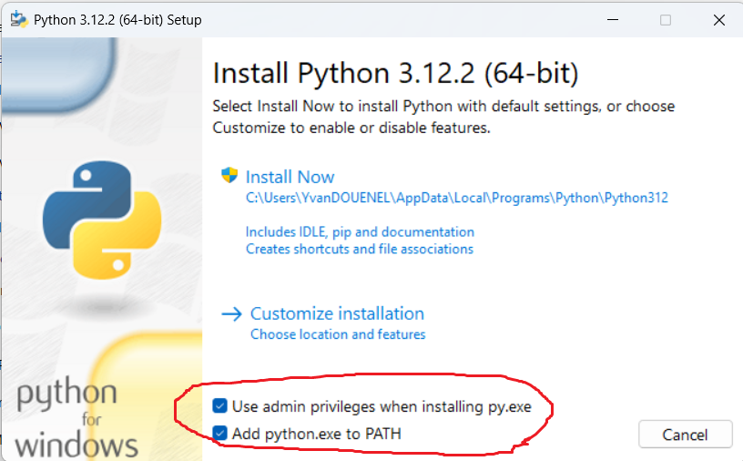
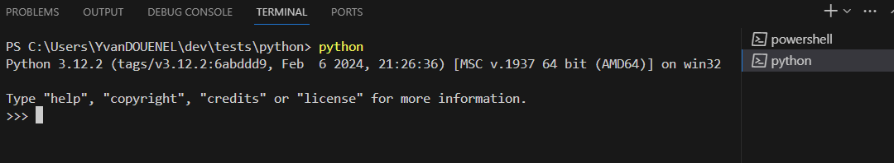
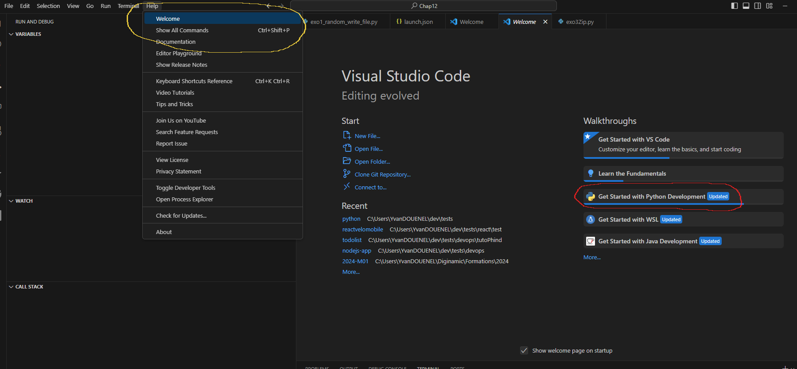
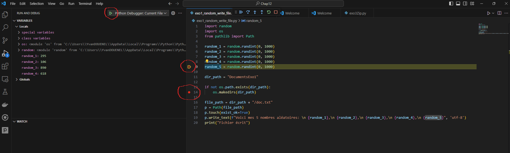
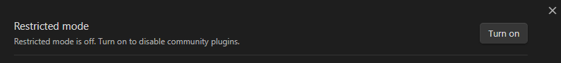

[Sommaire](Readme.md) · [Chapitre précédent →](00-02-introduction-a-python.md) · [Chapitre suivant →](01-les-variables.md)

# 00.3 - Installation du poste de travail

> On équipe la machine une bonne fois pour toutes : Python pour exécuter du code,
> Git pour récupérer et versionner le travail, VS Code pour l'écrire, et un
> notebook pour consigner ses notes exécutables. Prévoyez un moment calme : une
> installation bâclée se paie pendant tout le parcours.

**Durée :** ≈ 30 min (atelier ≈ 25 min + lecture) · **Prérequis :** une machine avec les droits d'installation de logiciels (Windows conseillé pour les captures de ce chapitre ; macOS et Linux fonctionnent à l'identique hors captures d'écran)

> 📖 Vocabulaire et acronymes : [glossaire du cours](A-Glossaire-et-ressources.md).

---

## Objectifs

À l'issue de ce chapitre, vous serez capable de :

- **Installer** Python en l'inscrivant dans les variables d'environnement.
- **Vérifier** depuis un terminal que l'interpréteur est accessible et qu'il répond.
- **Configurer** VS Code avec l'extension Python et un formateur automatique.
- **Exécuter** un premier script, puis le lancer en mode débogage avec un point d'arrêt.
- **Préparer** un espace de notes exécutables et un dossier de travail versionné.

---

## I. Installer Python

1. Rendez-vous sur [python.org](https://www.python.org), cliquez sur l'onglet **Downloads** et téléchargez la dernière version de **Python 3** (3.11 ou plus récent).
2. Ouvrez l'exécutable et, dès le premier écran, **cochez la case « Add Python 3.x to PATH »** : le `PATH` est la variable d'environnement qui indique au terminal dans quels dossiers chercher les programmes ; cocher cette case y inscrit Python, sans quoi la commande `python` sera introuvable.

 

3. Cliquez sur **Customize installation**.
4. Vérifiez que toutes les cases sont cochées, puis cliquez sur **Next**.
5. Cochez **Install for all users** et laissez les autres options telles quelles.
6. Acceptez l'installation.
7. À la fin, cliquez sur **Disable path length limit** et acceptez comme auparavant.
8. Fermez la fenêtre finale et ouvrez une invite de commande.
9. Tapez `python` (ou `py`) puis appuyez sur Entrée.
10. Si le terminal vous donne accès à un interpréteur Python, l'installation est complète. Tapez `exit()` pour en sortir.

 

### Vérifier la version installée

| Système | Commande |
| --- | --- |
| Windows | `python --version` |
| macOS et Linux | `python3 --version` |

La commande affiche le numéro de version complet de l'interpréteur, préfixé par le
mot `Python`. Sur macOS et Linux, la commande `python` désigne parfois encore
Python 2 ou n'existe pas : d'où le `python3` de la colonne de droite.

### Un mot sur les environnements

Une bonne pratique consiste à utiliser un **environnement virtuel** propre à chaque
projet. Une fois cet environnement activé, tous les paquets que vous installez sont
isolés des autres environnements — y compris de l'environnement global de
l'interpréteur. Cela évite la plupart des complications dues à des conflits de
versions de paquets entre deux projets.

Le chapitre final de ce cours y est consacré pour de bon. Pour l'instant, retenez
seulement que Python installé « globalement » suffit pour apprendre : vous travaillerez
en environnement virtuel dès que vous travaillerez sur un vrai projet.

---

## II. Installer Git

1. Rendez-vous sur [le site de Git](https://git-scm.com/downloads) et téléchargez la version correspondant à votre système.
2. Laissez toutes les options par défaut et cliquez sur **Next** à chaque écran jusqu'à la fin de l'installation.

> 🧪 **Atelier rapide (2 min)**
>
> Ouvrez Git Bash (ou votre terminal habituel) et lancez `git --version`. La
> commande doit répondre un numéro de version. Si elle ne répond pas, fermez et
> rouvrez le terminal : l'inscription au `PATH` ne devient visible qu'au
> démarrage d'une nouvelle session.

---

## III. Installer et configurer VS Code

1. [Téléchargez VS Code](https://code.visualstudio.com) (**VS Code**, l'éditeur de code de Microsoft, gratuit et multiplateforme).
2. Procédez à l'installation en laissant les options par défaut.
3. Une fois dans VS Code, ouvrez l'onglet **Extensions** et tapez `python` dans la barre de recherche.
4. Installez la première extension suggérée (celle de Microsoft, publiée par `ms-python`).
5. Créez un fichier Python (extension `.py`), tapez `print('Coucou')` et sauvegardez avec `Ctrl + S`.
6. Cliquez sur l'icône en forme de triangle pour exécuter votre script : `Coucou` s'affiche dans le terminal intégré.

### A. Formater le code automatiquement

Rien n'oblige à formater soi-même : l'extension **Black Formatter** s'en charge.
Recommandée, elle écrit votre code selon les conventions de la PEP 8
(**Python Enhancement Proposal** n° 8, le document qui fixe le style attendu en
Python) à chaque sauvegarde : <https://marketplace.visualstudio.com/items?itemName=ms-python.black-formatter>.

Ouvrez le fichier `settings.json` et ajoutez-y ces lignes (attention à préserver la
syntaxe JSON de l'ensemble du fichier) :

```json
"[python]": {
    "editor.defaultFormatter": "ms-python.black-formatter",
    "editor.formatOnSave": true
  }
```

### B. Créer un projet Python depuis l'accueil

Depuis la page d'accueil de VS Code, déroulez le processus d'installation d'un
projet Python : l'éditeur propose de créer le dossier, d'y installer un
environnement virtuel et d'y installer les outils de base.



### C. Exécuter pas à pas avec le débogueur

Le mode **debug** (exécution pas à pas) nécessite au moins un **point d'arrêt** :
cliquez dans la gouttière, à gauche du numéro d'une ligne. Lancez ensuite avec la
flèche verte : la colonne de gauche affiche alors les valeurs des variables, ligne
par ligne, pendant que le programme s'arrête sur votre point d'arrêt.



C'est l'outil le plus utile de votre parcours d'apprentissage : au lieu de deviner
ce que contient une variable, vous la regardez.

---

## IV. Préparer son espace de notes : Obsidian

[Obsidian](https://obsidian.md) est un logiciel de notes en Markdown, gratuit, qui
peut aussi exécuter des blocs de code. Vos notes deviennent des brouillons de code
essaiables.

1. Téléchargez Obsidian et installez-le normalement sur votre machine.
2. Une fois ouvert, créez un **coffre** (un dossier de notes) à l'emplacement de votre choix.
3. Cliquez sur l'icône « engrenage » en bas à gauche et allez dans l'onglet **Plugins de la communauté**.
4. Désactivez le **Restricted mode** (mode restreint), sans quoi aucune extension ne peut être installée.

 

5. Installez les plugins suivants :
   - Execute Code
   - Editor Syntax Highlight
6. Activez-les une fois installés.
7. Créez un nouveau dossier `Python` dans votre coffre.

### Cloner le support de cours dans le coffre

1. Ouvrez un terminal et placez-vous dans le dossier `Python` nouvellement créé.
2. Lancez un `git clone` avec l'URL du dépôt du cours que vous avez reçue : c'est par ce dépôt que le support et les exercices vous sont fournis, et c'est là que vous reprendrez votre travail d'une session à l'autre.

---

## Points clés

- **Cochez « Add Python to PATH »** : c'est la case qui rend la commande `python` disponible partout.
- On vérifie une installation avec `python --version` (Windows) ou `python3 --version` (macOS, Linux).
- VS Code + extension Python + Black Formatter = écrire, exécuter et formater sans y penser.
- Un **point d'arrêt** et le mode debug remplacent des heures de `print()` pour comprendre un programme.
- Un environnement virtuel par projet isolera plus tard vos dépendances ; l'installation globale suffit pour ce cours.
- Notes exécutables et dépôt cloné : votre travail doit survivre à la séance et se retrouver.

---

## 🧠 Vérifiez vos acquis

*Formatif, jamais noté. Répondez sans relire le chapitre. Les réponses se déplient juste après le séparateur : ce qui compte est de repérer où vous vacillez, pas de faire 5 sur 5.*

**1.** À quoi sert la case « Add Python 3.x to PATH » lors de l'installation ?

- A. Elle inscrit Python dans les variables d'environnement, ce qui rend la commande accessible depuis n'importe quel terminal
- B. Elle télécharge automatiquement les bibliothèques NumPy et Django pour ne plus y revenir
- C. Elle crée un environnement virtuel par projet, activé à chaque ouverture du terminal
- D. Elle remplace l'invite de commandes Windows par l'interpréteur Python de VS Code

**2.** Quelle commande vérifie la version de Python sur macOS ou Linux ?

- A. `python --version`, valable sur tous les systèmes d'exploitation sans exception
- B. `python3 --version`, car `python` y désigne parfois encore Python 2, ou n'existe pas
- C. `py --version`, qui est la commande universelle de l'interpréteur
- D. `pip --version`, qui affiche au passage la version de l'interpréteur

**3.** Que doit-on faire avant qu'un point d'arrêt permette d'exécuter un programme pas à pas ?

- A. Installer une seconde extension dédiée au débogage, distincte de l'extension Python
- B. Ajouter un point d'arrêt dans la gouttière, à gauche du numéro de ligne, puis lancer avec la flèche verte
- C. Enregistrer le fichier sous un nom sans accent ni espace, condition du mode pas à pas
- D. Remplacer tous les `print()` du script par des commentaires décrivant les valeurs attendues

**4.** Pourquoi attendre l'ouverture d'un nouveau terminal après l'installation de Git ?

- A. Parce que le terminal ne découvre les variables d'environnement mises à jour qu'à sa propre ouverture
- B. Parce que Git Bash refuse de démarrer plus de deux fois sur la même session
- C. Parce que l'installation de Git écrase la configuration du terminal déjà ouvert
- D. Parce que le démon Git doit redémarrer une fois avant d'accepter des commandes

**5.** *Question ouverte (2-3 lignes).* Vous rouvrez votre machine deux jours plus tard et la commande `python` ne répond plus. En vous appuyant sur ce chapitre, quelles deux causes vérifiez-vous en premier, et comment ?

---

<details>
<summary>Vérifier ses réponses</summary>

### Réponses

**1. A.** La case inscrit Python dans les variables d'environnement : sans elle, `python` reste introuvable dans le terminal alors que Python est bien installé.
**Pourquoi :** c'est précisément ce que signale le chapitre, « sans quoi la commande `python` sera introuvable dans le terminal ».

**2. B.** Sur macOS et Linux, on teste avec `python3 --version` parce que `python` peut désigner Python 2 ou ne pas exister.
**Pourquoi :** le tableau du chapitre sépare Windows (`python --version`) de macOS et Linux (`python3 --version`), et la note qui le suit explique ce décalage d'historique.

**3. B.** Sans point d'arrêt créé dans la gouttière, le débogueur ne s'arrête nulle part : on place le point d'arrêt, puis on lance avec la flèche verte.
**Pourquoi :** le chapitre décrit exactement cet enchaînement, et ajoute que la colonne de gauche affiche alors les valeurs des variables.

**4. A.** Les variables d'environnement sont chargées à l'ouverture du terminal : une session déjà ouverte ne les voit pas, il faut la rouvrir.
**Pourquoi :** c'est l'astuce donnée dans l'atelier du chapitre pour le cas où `git --version` ne répond pas juste après l'installation.

**5.** Attendu : on vérifie d'abord que la case « Add Python to PATH » a bien été cochée (ou que le `PATH` contient le dossier d'installation de Python), et on vérifie ensuite la bonne commande pour le système (`py` ou `python` sous Windows, `python3` sur macOS/Linux), en relançant un terminal neuf dans les deux cas.
**Pourquoi :** les deux causes les plus fréquentes d'une commande absente sont une inscription au `PATH` manquante et une commande mal orthographiée pour le système ; un terminal ouvert avant l'installation produirait le même symptôme, d'où la relance de session.

</details>

---

[Sommaire](Readme.md) · [Chapitre précédent →](00-02-introduction-a-python.md) · [Chapitre suivant →](01-les-variables.md)
