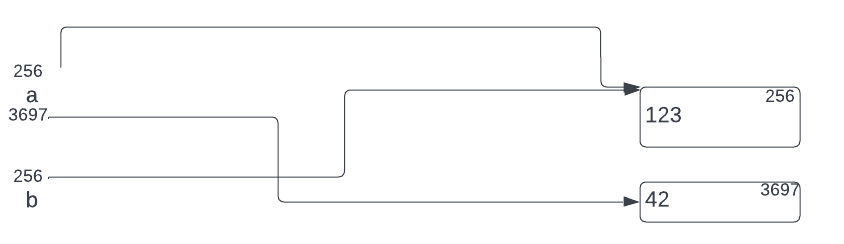

[← Chapitre précédent](04-les-booleens.md) · [Sommaire](Readme.md) · [Chapitre suivant →](06-les-constructeurs-de-types.md)

# 05 - Les variables, notions plus avancées

> Deux variables qui portent la même valeur ne sont pas deux boîtes identiques :
> ce sont parfois deux étiquettes collées sur le même objet. Ce chapitre installe
> cette image — c'est elle qui explique la moitié des comportements surprenants des
> débutants.

**Durée :** ≈ 25 min (lecture ≈ 12 min + atelier ≈ 13 min) · **Prérequis :** [Les variables](01-les-variables.md) à [Les booléens](04-les-booleens.md) ; les tuples et dictionnaires sont expliqués au moment d'être utilisés ici

> 📖 Vocabulaire et acronymes : [glossaire du cours](A-Glossaire-et-ressources.md).

---

## Objectifs

À l'issue de ce chapitre, vous serez capable de :

- **Lire** la valeur renvoyée par la fonction `id()` et dire ce qu'elle représente.
- **Prévoir** si deux variables partagent le même objet, avant et après réaffectation.
- **Écrire** une affectation multiple et une affectation parallèle.
- **Échanger** les valeurs de deux variables sans variable temporaire.
- **Repérer** les écritures compactes illisibles et les éviter.

---

## I. Ce que renvoie `id()`

### A. Un identifiant, pas une adresse mémoire

En Python, la fonction `id()` ne renvoie pas l'adresse mémoire d'un objet. Elle
renvoie un **identifiant unique** pour cet objet, utilisé par le système de gestion
de la mémoire de Python. L'adresse mémoire réelle n'est pas directement accessible
par les fonctions de la bibliothèque standard : Python efface ces détails pour
offrir un environnement de programmation de plus haut niveau, plus sûr et plus
portable.

Dans une optique pédagogique, on peut donc considérer que ce que retourne `id()`
est l'identifiant de l'espace mémoire dans lequel est stockée la valeur de la
variable. Ce qui compte n'est pas la valeur de cet identifiant, mais ce qu'on en
déduit : **deux variables qui affichent le même `id()` désignent le même objet**.

```python
ma_variable = 55
print("id de ma_variable: ", id(ma_variable))
```

### B. Deux variables peuvent désigner un seul objet

L'exemple suivant montre que les affectations font **pointer** les variables vers
un même espace mémoire, alors qu'une **réaffectation** fait changer d'espace :

```python
a = 123
b = a # les deux variables désignent le même objet
print("id de a: ", id(a))
print("id de b: ", id(b)) # même identifiant

# a va changer d'objet lors de la nouvelle assignation, tandis que b reste sur le premier
a = 42
print("id de a: ", id(a))
print("id de b: ", id(b))
# les identifiants de a et b ne coïncident donc plus
```



Écrivez ce script et exécutez-le avant de continuer : c'est en voyant les
identifiants se ressembler puis diverger que l'image devient solide.

> 💡 **Vocabulaire**
>
> On parle souvent de « passage par référence » pour `b = a`. Plus exactement, en
> Python une variable est un **nom lié à un objet** : `b = a` ne copie pas la
> valeur, il ajoute une deuxième étiquette sur le même objet. `a = 42` détache
> l'étiquette `a` et la colle sur un nouvel objet.

---

## II. Les affectations multiples

Les **affectations multiples** déclarent et affectent plusieurs variables à la même
valeur en une seule ligne. Utile au début d'un programme pour poser des valeurs par
défaut :

```python
a = b = c = 0
# a = b = 0 = c   # syntaxe invalide
```

La seconde ligne, commentée ici, ne s'écrirait jamais : Python refuse d'affecter une
valeur à une valeur.

---

## III. Les affectations parallèles

Très pratique avec les tuples, les dictionnaires, les listes — tout ce qui contient
plusieurs informations — l'**affectation parallèle** affecte plusieurs variables en
même temps, en appliquant les valeurs de gauche à droite dans l'ordre.

### A. Avec des entiers, et l'échange classique

```python
a, b = 2, 3
a, b = b, a
```

La deuxième ligne échange les valeurs de `a` et `b` **sans variable temporaire** —
pas besoin d'un `c` pour stocker une valeur pendant l'échange.

### B. Avec un tuple

```python
mon_tuple = ("2", 3)

a, b = mon_tuple
print(a, type(a)) # 2 <class 'str'>
print(b, type(b)) # 3 <class 'int'>
```

Le tuple contenait une **chaîne** `"2"` et un **entier** `3` : les types suivent les
valeurs, pas l'ordre de lecture.

### C. Avec un dictionnaire

```python
mon_dict = {
    1: "toto",
    "element": 42,
    "valide": True
}

a, b, c = mon_dict["element"], mon_dict[1], mon_dict["valide"]
print(a, type(a)) # 42 <class 'int'>
print(b, type(b)) # toto <class 'str'>
print(c, type(c)) # True <class 'bool'>
```

Ici, le côté droit est une liste de trois valeurs cherchées dans le dictionnaire, le
côté gauche trois variables : l'appariement se fait position par position.

> ⚠️ **L'exemple à ne pas copier**
>
> À utiliser dans la limite du raisonnable, sous peine de vous faire maudire par
> vos collègues. Extrait réel d'un script de robot de messagerie (`message` n'est
> pas défini dans ce cours, il sert ici de témoin) :

```python
infos, name, address = message.content.split(':')[0], message.content.split('[')[0], message.content.split(';')[4]
```

Une seule ligne, trois découpes différentes, trois variables : personne ne pourra
la relire six mois plus tard. Quand l'affectation parallèle dépasse deux ou trois
termes évidents, reprenez-la en lignes séparées.

---

### Exercice 1 — Utiliser la fonction `id()` (≈ 3 min)

- Initialisez une variable `x` avec une valeur entière.
- Utilisez la fonction `id()` pour afficher l'identifiant de `x`.

**Avant d'ouvrir la correction**, vérifiez que :

- [ ] Votre appel à `id()` est bien passé à l'intérieur de `print()`.
- [ ] Le script affiche un grand nombre entier.

<details>
<summary>Corrigé</summary>

```python
x = 42
print(id(x))
```

L'identifiant affiché dépend de l'exécution : ne cherchez pas à retrouver le même
nombre d'un lancement à l'autre. Ce qui se compare, ce sont deux identifiants
obtenus **dans le même programme**.

</details>

### Exercice 2 — Passage par référence (≈ 5 min)

- Déclarez une variable `a` et assignez-lui une valeur entière.
- Affectez la valeur de `a` à une nouvelle variable `b`. Affichez leurs identifiants.
- Modifiez la valeur de `a` et vérifiez si les identifiants de `a` et `b` ne sont plus les mêmes.

**Avant d'ouvrir la correction**, vérifiez que :

- [ ] Vous affichez les deux identifiants **avant** et **après** la modification.
- [ ] Vous êtes capable de dire, avant d'exécuter, lequel des deux couples est identique.

<details>
<summary>Corrigé</summary>

```python
a = 42
b = a
print(id(a), id(b)) # les deux identifiants coïncident

a = 1
print(id(a), id(b)) # ils divergent : a désigne un nouvel objet, b est resté sur l'ancien
```

`b = a` a collé une seconde étiquette sur le même objet. La réaffectation
`a = 1` ne modifie pas l'objet : elle détache l'étiquette `a` et la pose sur
l'objet `1`. C'est exactement ce que montrait le schéma du début du chapitre.

</details>

### Exercice 3 — Affectations multiple et parallèle (≈ 5 min)

- Initialisez deux variables `message1` et `message2` avec des chaînes de caractères différentes en même temps.
- Utilisez l'affectation parallèle pour échanger les valeurs de `message1` et `message2`.
- Affichez les valeurs de `message1` et `message2` pour vérifier l'échange.

**Avant d'ouvrir la correction**, vérifiez que :

- [ ] Vos deux variables sont initialisées sur une seule ligne.
- [ ] L'échange tient aussi sur une seule ligne, sans variable intermédiaire.
- [ ] L'affichage final montre les deux valeurs permutées.

<details>
<summary>Corrigé</summary>

```python
message1, message2 = "Hello", "World"
message1, message2 = message2, message1
print(message1, message2)
```

La ligne d'échange construit d'abord le côté droit avec les **anciennes** valeurs,
puis affecte côté gauche. C'est ce qui rend l'écriture sûre là où, dans un autre
langage, il faudrait une troisième variable.

</details>

---

## Points clés

- `id()` renvoie un **identifiant d'objet**, pas une adresse mémoire ; deux `id()`
  égaux signifient deux noms sur **un même objet**.
- `b = a` **ne copie pas** : il ajoute une étiquette. `a = ...` **réaffecte** : il
  déplace l'étiquette.
- Affectation **multiple** : `a = b = c = 0`. Affectation **parallèle** :
  `a, b = 2, 3`.
- L'échange `a, b = b, a` ne demande aucune variable temporaire.
- Une affectation parallèle à rallonge est une **dette de lisibilité** : on la
  découpe.

---

## 🧠 Vérifiez vos acquis

*Formatif, jamais noté. Répondez sans relire le chapitre. Les réponses se déplient juste après le séparateur : ce qui compte est de repérer où vous vacillez, pas de faire 5 sur 5.*

**1.** Que renvoie `id(objet)` ?

- A. L'adresse mémoire exacte de l'objet, telle que la lirait le système d'exploitation
- B. Un identifiant unique pour l'objet, utilisé par la gestion de la mémoire de Python
- C. Le numéro de la ligne du script où la variable a été déclarée pour la première fois
- D. Le nom interne de la classe de l'objet, sous forme de chaîne de caractères

**2.** Après `a = 123` puis `b = a`, que peut-on dire des identifiants ?

- A. Ils sont identiques, puisque les deux noms désignent le même objet
- B. Ils diffèrent, puisque chaque variable reçoit sa propre copie de la valeur
- C. Ils sont identiques tant que l'on ne lit pas la variable `b`
- D. Ils diffèrent, puisque `b` pointe vers le nom `a` et non vers sa valeur

**3.** Après `a = 42` puis `b = a` puis `a = 1`, que devient `b` ?

- A. `b` vaut 1, le changement s'étant propagé à toutes les étiquettes de l'objet
- B. `b` vaut toujours 42, la réaffectation ayant déplacé seulement le nom `a`
- C. `b` devient indéfinie, l'objet qu'elle désignait ayant été supprimé
- D. `b` lève une erreur à la lecture, sa référence étant devenue pendante

**4.** Quelle ligne échange les valeurs de `a` et `b` ?

- A. `a = b; b = a`, puisque les affectations se lisent de gauche à droite
- B. `a, b = b, a`, le côté droit étant construit avec les anciennes valeurs
- C. `a == b`, la comparaison provoquant l'échange des deux objets
- D. `a = b = a`, l'affectation multiple rétablissant la symétrie des deux noms

**5.** *Question ouverte (2-3 lignes).* Expliquez avec l'image des étiquettes pourquoi `a = b = c = 0` puis `a = 5` laisse `b` et `c` à zéro.

---

<details>
<summary>Vérifier ses réponses</summary>

### Réponses

**1. B.** `id()` renvoie un identifiant unique utilisé par le gestionnaire de mémoire ; l'adresse mémoire réelle n'est pas exposée par la bibliothèque standard.
**Pourquoi :** le chapitre explique ce choix — masquer la gestion mémoire rend le langage plus sûr et plus portable — et invite à lire l'identifiant comme l'espace où vit la valeur.

**2. A.** `b = a` n'a pas copié la valeur : les deux noms sont collés sur le même objet, donc leurs identifiants coïncident.
**Pourquoi :** c'est la première moitié du script d'illustration, et le haut du schéma du chapitre.

**3. B.** `b` vaut toujours 42 : `a = 1` a détaché l'étiquette `a` vers un autre objet, sans toucher à `b`.
**Pourquoi :** c'est la seconde moitié du script, qui affiche deux identifiants divergents. Un nom réaffecté ne modifie pas l'objet visé par les autres noms.

**4. B.** `a, b = b, a` : Python évalue tout le côté droit avec les valeurs actuelles, puis affecte le côté gauche.
**Pourquoi :** le chapitre en fait l'exemple type de l'affectation parallèle, et l'exercice 3 le rejoue sur des chaînes. La réponse A, elle, écrase `a` avant de pouvoir l'attribuer à `b`.

**5.** Attendu : après `a = b = c = 0`, les trois noms sont collés sur le même objet `0` ; `a = 5` détache uniquement l'étiquette `a` vers l'objet `5`, laissant `b` et `c` sur `0`.
**Pourquoi :** une affectation déplace un nom, elle ne perce pas l'objet pour y changer la valeur — c'est exactement le mécanisme montré avec `a = 42` puis `b = a`.

</details>

---

[← Chapitre précédent](04-les-booleens.md) · [Sommaire](Readme.md) · [Chapitre suivant →](06-les-constructeurs-de-types.md)
