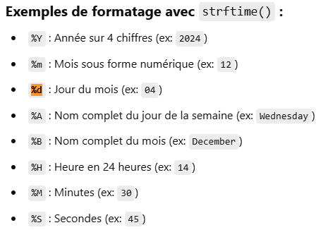

[← Chapitre précédent](09-les-operateurs-mathematiques.md) · [Sommaire](Readme.md) · [Chapitre suivant →](11-les-structures-conditionnelles.md)

# 10 - Formatter les chaînes de caractères

> Afficher `"Résultat : 42"` ne se fait pas de la même main qu'afficher
> `"Résultat : " + str(42)`. Le premier écrit un **modèle** où la valeur vient se
> glisser ; le second empile des morceaux et compte sur vous pour les bonnes
> conversions. Ce chapitre présente les cinq façons de faire, de la plus utilisée
> à la plus artisanale.

**Durée :** ≈ 30 min (lecture ≈ 14 min + atelier 10 min + réflexion 6 min) · **Prérequis :** [Les méthodes de chaînes de caractères](08-les-methodes-de-chaines-de-caracteres.md), [Les opérateurs mathématiques](09-les-operateurs-mathematiques.md)

> 📖 Vocabulaire et acronymes : [glossaire du cours](A-Glossaire-et-ressources.md).

---

## Objectifs

À l'issue de ce chapitre, vous serez capable de :

- **Injecter** une variable, et même une expression, dans une chaîne avec une f-string.
- **Réutiliser** une chaîne préparée grâce à la méthode `format()`.
- **Formater** une valeur : combler avec des zéros, écrire une date, tronquer.
- **Reconnaître** les écritures plus anciennes (`%` et `+`) et dire quand elles restent utiles.

---

> 📌 Ce chapitre est présenté dans l'**ordre décroissant d'utilisation** : on
> commence par ce que vous écrirez tout le temps, et on finit par ce que vous
> croiserez dans du code ancien.

---

## I. Injecter des variables avec les f-strings

Pour **concaténer plusieurs variables** dans une f-string (de l'anglais *formatted string*, « chaîne formatée »), il suffit de précéder la chaîne de la lettre `f` et d'englober les variables entre `{}`.

```python
x = 2
y = 3

# va nous donner le résultat "L'addition de 2 et 3 est égale à 5"
print(f"L'addition de {x} et {y} est égale à {x + y}")

x = [1, 2, 3]

# va nous donner le résultat "la string de la liste [1, 2, 3]"
print(f"la string de la liste {x}")
```

Notez `{x + y}` : entre accolades, on peut mettre une **expression**, pas seulement un nom de variable. Et une liste s'affiche telle quelle, sans conversion manuelle.

On peut également faire des f-string multilignes.

```python
x = 12

phrase = f"""Longue phrase 
avec une variable {x}
dedans.
"""

print(phrase)
```

> 📘 **Compatibilité.** Les f-strings sont apparues avec la version 3.7 de Python
> et sont maintenant la méthode à privilégier.

---

## II. Réutiliser une chaîne avec la méthode `format()`

La méthode `format()` était la méthode principale utilisée pour concaténer des variables dans une chaîne avant l'arrivée des f-strings. Reprenons l'exemple précédent.

```python
x = 2
y = 3

print("L'addition de {premier} et {second} est égale à {addition}".format(premier=x, second=y, addition=x+y))
```

On peut également l'utiliser sans nommer les paramètres, à condition de suivre quelques règles.

```python
ceci = "ceci"
cela = "cela"

# il faut le même nombre de paramètres que de {}
print("Je peut printer {} et {}".format(ceci, cela))

# ou alors on utilise des indices
print("Je peut printer {0} et {0}".format(ceci))
```

Avec les indices, un même argument peut servir plusieurs fois : c'est ce que `{0}` répété va chercher deux fois le premier paramètre.

> 📘 La fonction `format()` est toujours pertinente.
>
> Dans certains cas, elle est plus intéressante que les f-strings lorsque l'on
> veut **préparer la chaîne avant l'existence des variables** à concaténer : le
> modèle `"Bonjour {prenom}"` peut vivre dans un fichier de configuration, puis
> être rempli plus tard. Une f-string, elle, a besoin de la variable au moment où
> elle s'écrit.

---

## III. Les options de formatage

Ces options fonctionnent avec les f-strings et avec la fonction `format()`. Elles suivent toutes la syntaxe suivante : `f"{valeur:formatage}"` — un deux-points, puis le code de formatage.

### A. « Padder » un nombre

```python
x = 123
formatage = f"formatage de {x:04d} pour être sûr qu'il est composé de 4 chiffres"
print(formatage)
```

Explications : la traduction de *to pad* est « compléter ».

- le `0` indique que l'expression doit être complétée, le cas échéant, par des zéros ;
- le `4` indique que l'expression doit contenir au moins 4 chiffres ;
- le `d` indique que l'expression doit être formatée comme un entier décimal.

> 📌 **Exemple d'utilisation.** Lorsque l'on veut harmoniser les données dans un
> tableau, ou lors du stockage de fichiers numérotés : `facture-0007.txt` se range
> dans l'ordre, `facture-7.txt` non.

### B. Formater une date

```python
from datetime import date

date_us = date(2022, 12, 24) # création d'un object date

date_fr = f"Avec des slashs, c'est quand même plus lisible : {date_us:%d/%m/%Y}"

print(date_fr)
```

Ici nous utilisons les spécifications de formatage d'un objet `date` issu de `datetime`. Vous trouverez plus de détails sur les spécifications de format de date à l'adresse suivante : <https://docs.python.org/3/library/datetime.html#datetime.date.strftime>

Résumé :



### C. Tronquer une chaîne de caractères

```python
flute_a_bec = """
Souvent moquée et montrée du doigt, la flûte à bec est généralement mise de côté quand il s'agit d'être choisie quand on veut commencer un instrument. Jugée trop simple, petite, pas Rock'n Roll, et surtout associée aux cours de musique à l'école, la flûte n'a pas bonne réputation.
"""

print(f"{flute_a_bec:.35}...") # n'affichera que les 35 premiers caractères suivie de ...
```

Le point suivi d'un nombre (`:.35`) limite donc la longueur affichée : pratique pour tenir une ligne dans un tableau ou un titre.

---

## IV. Concaténer avec l'opérateur `%`

On peut utiliser le caractère `%` pour intégrer des variables dans une chaîne préparée.

```python
age = 12

concat = "Bonjour j'ai %d ans" % age
print(concat) # sera casté en integer

concat = "Bonjour j'ai %f ans" % age
print(concat) # sera casté en float
```

Cette écriture, héritée du langage C, se lit encore dans beaucoup de scripts : `%d` pour un entier, `%f` pour un à virgule. Elle n'a plus de raison d'être dans du code neuf, mais il faut la reconnaître.

---

## V. Concaténer avec l'opérateur `+`

Fastidieux, et vulnérable aux erreurs de conversion.

```python
x = 1
y = 2

print("Je concatene " + str(x) + " et " + str(y) + " avec +, quel plaisir.")
```

Chaque valeur qui n'est pas déjà une chaîne doit passer par `str()`, faute de quoi Python refuse d'additionner du texte et un nombre. C'est précisément ce travail que les quatre écritures précédentes font à votre place.

---

### Exercice 1 — Le bulletin de naissance (~10 min)

```python
# À partir des variables suivantes, et sans les modifier, formater la chaîne suivante pour obtenir le résultat suivant :
# "Bonjour, je m'appelle Bobby, j'ai 0030 ans, je suis né le May 26 1992."

# Printer la phrase

from datetime import date 

prenom         = "bobby"
age            = 30
date_naissance = date(1992, 5, 26)
```

**Avant d'ouvrir le corrigé**, vérifiez que :

- [ ] Vous n'avez modifié aucune des trois variables données.
- [ ] Le `B` majuscule de « Bobby » vient d'une **méthode de chaîne**, pas d'une réécriture à la main.
- [ ] Le `0030` vient d'une **option de formatage**, pas d'une concaténation de zéros.
- [ ] La date est produite par un code de formatage, et non en tapant mois, jour et année dans l'ordre.

*Pour aller plus loin (facultatif).* Refaites la même phrase avec la méthode `format()` et des paramètres nommés, sans f-string.

<details>
<summary>Corrigé</summary>

```python
# À partir des variables suivantes, et sans les modifier, formater la chaîne suivante pour obtenir le résultat suivant :
# "Bonjour, je m'appelle Bobby, j'ai 0030 ans, je suis né le May 26 1992."
# Printer la phrase

from datetime import date 

prenom         = "bobby"
age            = 30
date_naissance = date(1992, 5, 26)

print(f"Bonjour, je m'appelle {prenom.capitalize()}, j'ai {age:04d}, je suis né le {date_naissance:%b %d %Y}")
```

Trois mécanismes du chapitre sont mobilisés d'un coup :

- `prenom.capitalize()` remet la première lettre en majuscule (méthode de chaîne, vue au chapitre précédent — rappelez-vous qu'elle **retourne** une nouvelle chaîne) ;
- `{age:04d}` comble avec des zéros pour atteindre 4 chiffres ;
- `{date_naissance:%b %d %Y}` applique les codes de `strftime` : mois abrégé, jour, année.

**Sur le mois en anglais.** L'abréviation renvoyée par `%b` dépend de la locale configurée sur la machine. Par défaut, Python n'applique pas la locale système : le mois sort donc en anglais (`May`), ce qui est exactement ce que l'énoncé attend. Si vous localizez votre environnement, la sortie changera — ce n'est pas une erreur de votre code.

</details>

---

## Points clés

- La f-string (`f"...{variable}..."`) est la méthode à privilégier depuis Python 3.7 : elle accepte des expressions et n'exige aucune conversion manuelle.
- `format()` sert quand le **modèle existe avant les valeurs** : on prépare la chaîne, on la remplit plus tard.
- Un formatage s'écrit après un deux-points : `:04d` pour combler, `:%d/%m/%Y` pour une date, `:.35` pour tronquer.
- `%` et `+` restent à reconnaître : la première est héritée du C, la seconde oblige à convertir chaque valeur avec `str()`.
- Une chaîne est immuable : `capitalize()` et les options de formatage produisent une **nouvelle** chaîne.

---

## 🧠 Vérifiez vos acquis

*Formatif, jamais noté. Répondez sans relire le chapitre. Les réponses se déplient juste après le séparateur : ce qui compte est de repérer où vous vacillez, pas de faire 5 sur 5.*

**1.** Quelle écriture permet de remplir un modèle de chaîne alors que les variables n'existent pas encore ?

- A. Une f-string, car elle évalue l'expression entre accolades au moment où on le lui demande
- B. `"Bonjour {prenom}".format(prenom=value)`, car le modèle est écrit séparément des valeurs
- C. La concaténation avec `+`, car elle n'a besoin d'aucune variable pour fonctionner
- D. L'opérateur `%`, car il attend que la variable soit définie après la chaîne

**2.** Que doit-on écrire pour que la valeur `123` s'affiche avec quatre chiffres, complétée de zéros ?

- A. `{x:04d}`
- B. `{x:4}`
- C. `{x:.4}`
- D. `{x:%4d}`

**3.** Dans `f"a={a} et b={b} et total={a + b}"`, que se passe-t-il ?

- A. Une erreur : seules des variables seules ont le droit d'apparaître entre accolades
- B. L'expression est évaluée puis insérée, comme n'importe quelle valeur
- C. Le texte `{a + b}` est affiché tel quel, car Python n'évalue jamais rien dans une chaîne
- D. Python convertit toute la chaîne en nombre avant d'afficher le résultat de l'addition

**4.** Pourquoi `"Résultat : " + 42` pose-t-il problème, alors que `f"Résultat : {42}"` ne le pose pas ?

- A. Parce que `+` additionne des valeurs de même nature et refuse un texte avec un nombre, là où la f-string convertit la valeur
- B. Parce que la f-string est plus récente que l'opérateur `+` et corrige ce défaut de Python
- C. Parce que le nombre doit d'abord être rangé dans une variable pour apparaître dans une chaîne
- D. Parce que `+` ne sert qu'à additionner deux nombres et ne fonctionne jamais sur du texte

**5.** *Question ouverte (2-3 lignes).* Vous devez écrire le code de facture sur 5 chiffres (`00042`) et tronquer la désignation à 40 caractères. Écrivez la ligne qui fait les deux, et dites ce qui aurait été nécessaire avec la méthode `%`.

---

<details>
<summary>Vérifier ses réponses</summary>

### Réponses

**1. B.** `format()` sépare le modèle du moment où on le remplit.
**Pourquoi :** une f-string a besoin des variables **au moment où elle s'écrit** ; `%` et `+` sont dans le même cas. C'est tout l'intérêt de `"…{prenom}…".format(...)` : le modèle peut être stocké, chargé depuis un fichier, puis rempli plus tard.

**2. A.** `0` = compléter avec des zéros, `4` = au moins 4 chiffres, `d` = entier décimal.
**Pourquoi :** `:.4` tronque une chaîne à 4 caractères, `{x:4}` aligne sans combler de zéros, et `%4d` appartient à l'ancienne syntaxe `%`. Le code de formatage suit toujours le deux-points.

**3. B.** Entre accolades, on met une expression.
**Pourquoi :** Python évalue `a + b` puis insère le résultat. C'est ce qui évite d'écrire une variable intermédiaire pour un calcul d'affichage aussi simple.

**4. A.** `+` est strict sur les types.
**Pourquoi :** il faut écrire `"Résultat : " + str(42)` pour que ça passe — et oublier un `str()` est l'erreur classique de cette écriture. La f-string appelle la conversion de représentation à votre place.

**5.** Attendu, par exemple : `print(f"{reference:05d} - {designation:.40}")`. Avec `%`, il aurait fallu `%05d` pour le nombre, et `%s` suivi d'une troncature faite à la main (ou d'un slice `designation[:40]`), car `%` ne gère pas la coupure d'une chaîne par simple longueur de cette façon.
**Pourquoi :** les deux besoins relèvent du même mécanisme — le code de formatage placé après le deux-points — et l'ancienne syntaxe ne couvre pas la troncature aussi directement.

</details>

---

[← Chapitre précédent](09-les-operateurs-mathematiques.md) · [Sommaire](Readme.md) · [Chapitre suivant →](11-les-structures-conditionnelles.md)
