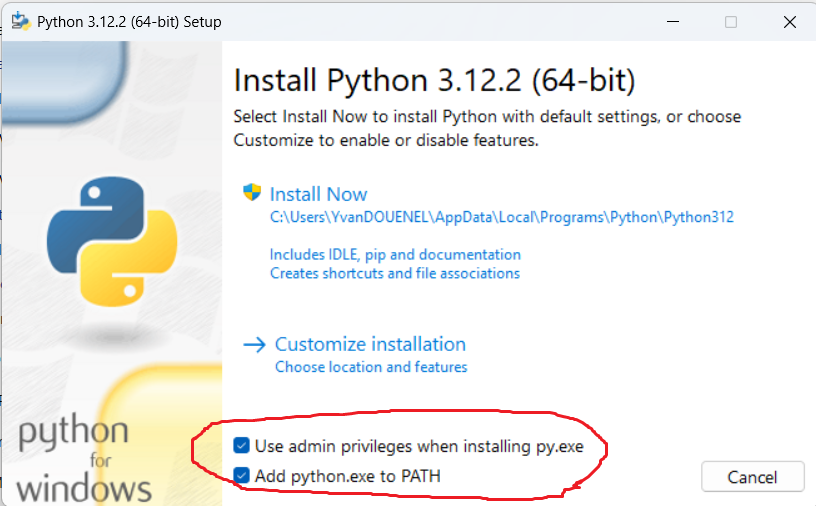
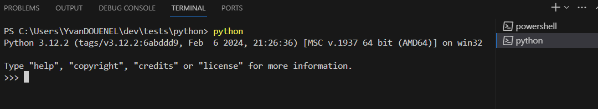
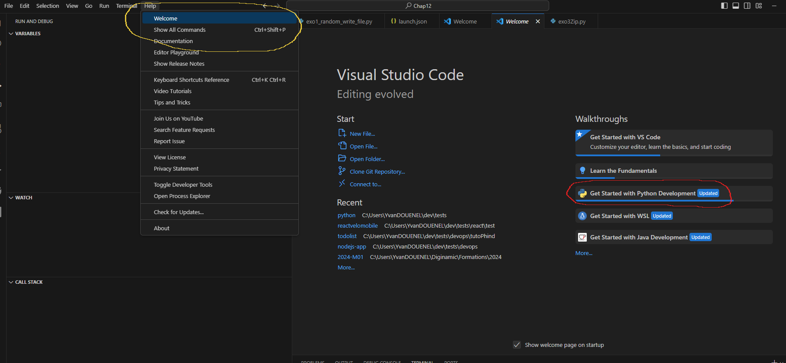
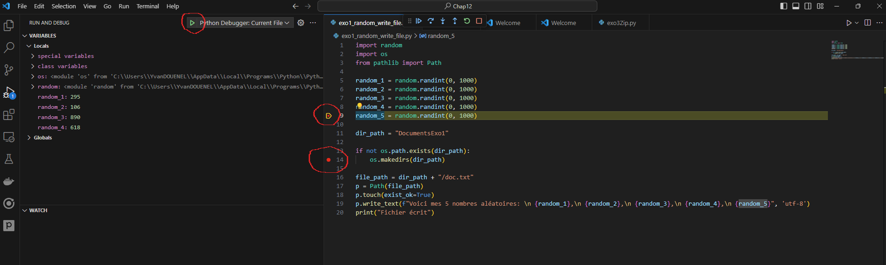
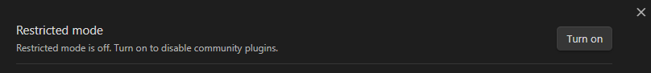
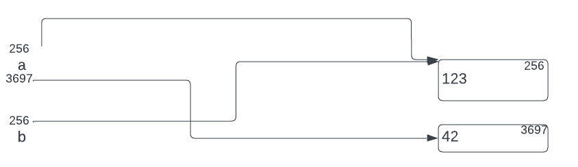
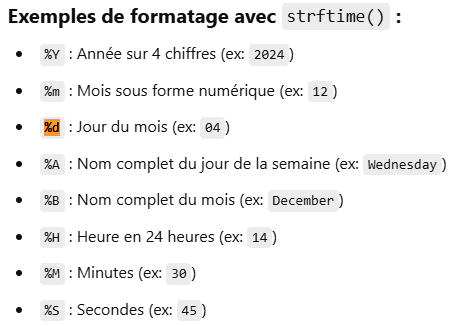

<!-- _class: lead -->

# Python impératif — les fondamentaux

## Deux journées, de la variable à l'environnement virtuel

---

<!-- _class: statement -->

> On n'apprend pas Python. On apprend à décrire des étapes, et Python exécute ce qu'on écrit — littéralement.

---

## Ce que couvre ce cours

- Les briques que vous retrouverez dans tous les langages et tous les projets.
- Jour 1 : les fondations — variables, types, chaînes, saisie, opérateurs, conditions, modules.
- Jour 2 : les conteneurs, les boucles, les fonctions, puis les réflexes professionnels — documenter, découper, isoler.
- Un travail pratique clos le cours : il mobilise l'ensemble de ces briques sur un jeu de données réel.

---

<!-- _class: lead -->

# Jour 1

## Des variables aux objets muables et immuables

---

## Agenda du jour 1

| Chapitre | Titre | Durée |
|---|---|---|
| 00.1 | Deux paradigmes : impératif et objet | 15 min |
| 00.2 | Introduction à Python | 10 min |
| 00.3 | Installation du poste de travail | 30 min |
| 01 | Les variables | 20 min |
| 02 | Les chaînes de caractères | 15 min |
| 03 | Les nombres | 10 min |
| 04 | Les booléens | 10 min |
| 05 | Les variables, notions plus avancées | 25 min |
| 06 | Les constructeurs de types | 15 min |
| 07 | Intéragir avec l'utilisateur | 10 min |
| 08 | Les méthodes de chaînes de caractères | 35 min |
| 09 | Les opérateurs mathématiques | 30 min |
| 10 | Formatter les chaînes de caractères | 30 min |
| 11 | Les structures conditionnelles | 40 min (+ 12 fac.) |
| 12 | Les modules standards de Python | 30 min (+ 8 fac.) |
| 13 | Les objets muables et immuables | 15 min |

≈ 340 min de lecture et d'ateliers, extensions facultatives non comptées.

---

<!-- _class: lead -->

# 00.1 - Deux paradigmes de programmation

## Comment on organise un programme

---

## La programmation impérative

- Un paradigme qui utilise des instructions pour modifier l'**état** d'un programme.
- Le programmeur décrit explicitement les étapes, la machine les exécute dans l'ordre.
- La métaphore de la recette : on écrit tout, du préchauffage du four à la sortie du four.
- L'ordinateur est un cuisinier très obéissant et très littéral.
- **C'est le paradigme de ce cours.**

---

## Impératif, déclaratif, objet

- **Impératif** = les étapes. **Déclaratif** = le résultat attendu, la machine choisit comment.
- En SQL on déclare ce qu'on veut récupérer ; en Python on écrit le comment.
- La programmation orientée objet est une autre manière d'imaginer, construire et organiser son code — ce sera le cours suivant.
- Les standards de code (PEP 8) fixent le style attendu : un code lisible par d'autres.

---

<!-- _class: lead -->

# 00.2 - Introduction à Python

## Un langage interprété, et alors ?

---

## Interprété, et donc lisible

- Créé par **Guido van Rossum**, version 1.0 publiée en **1991** ; exécuté ligne par ligne par un **interpréteur**, sans phase de compilation.
- Vous écrivez un fichier `.py` et vous le lancez directement.
- L'interpréteur s'arrête où est le problème et affiche un message qui dit où chercher.
- Le prix du confort : une exécution généralement plus lente qu'un programme compilé.
- **Syntaxe lisible** proche de l'anglais, **polyvalence** : web, données, automatisation, tests, administration système.
- **Grande communauté**, **bibliothèques puissantes** (NumPy, Django, TensorFlow) et **multiplateforme**.

---

<!-- _class: lead -->

# 00.3 - Installation du poste de travail

## Python, Git, VS Code, Obsidian

---

## Installer Python

1. python.org, onglet **Downloads**, dernière version de **Python 3** (3.11 ou plus récent).
2. Dès le premier écran, cocher **« Add Python 3.x to PATH »**.
3. **Customize installation**, toutes les cases cochées, puis **Install for all users**.
4. À la fin, **Disable path length limit**.
5. Tapez `python` (ou `py`) dans une invite de commande, puis `exit()`.



---

## Vérifier que l'interpréteur répond

```shell
python --version    # Windows
python3 --version   # macOS et Linux
```

| Système | Commande |
|---|---|
| Windows | `python --version` |
| macOS et Linux | `python3 --version` |



---

## Installer et configurer VS Code

- Extension **Python** (publiée par `ms-python`), puis un fichier `.py` et `print('Coucou')`.
- Le triangle lance le script dans le terminal intégré.
- **Black Formatter** formate selon la PEP 8 à chaque sauvegarde :

```json
"[python]": {
    "editor.defaultFormatter": "ms-python.black-formatter",
    "editor.formatOnSave": true
  }
```

---

## Créer un projet et déboguer

Depuis la page d'accueil de VS Code, l'éditeur propose de créer le dossier, d'y installer un environnement virtuel et les outils de base.



---

## Exécuter pas à pas avec le débogueur

- Un **point d'arrêt** dans la gouttière, à gauche du numéro de ligne.
- La flèche verte lance : la colonne de gauche affiche les valeurs des variables, ligne par ligne.



C'est l'outil le plus utile de votre apprentissage : au lieu de deviner ce que contient une variable, vous la regardez.

---

## Préparer son espace de notes : Obsidian

- Notes en Markdown, gratuite, qui **exécute** des blocs de code.
- Créer un **coffre**, désactiver le **Restricted mode**, installer **Execute Code** et **Editor Syntax Highlight**.
- Créer un dossier `Python` et y `git clone` le dépôt du cours : c'est là que vous reprenez votre travail d'une session à l'autre.



---

<!-- _class: lead -->

# 01 - Les variables

## Stocker pour réutiliser

---

## Ce que fait une variable

```python
ma_variable = 4
print(ma_variable + 3) # 7
```

- Le nom `ma_variable` désigne la valeur `4`.
- Elle devient indispensable dès que la valeur arrive d'un calcul, d'un fichier ou du clavier.
- Cycle de vie : déclaration, affectation, lecture, suppression automatique (**ramasse-miettes**).
- **Typage dynamique** : vous n'écrivez jamais le type.

---

## Des noms de variables valides

Le langage impose :

- pas de chiffre en tête, pas d'espace, que des caractères alphanumériques et `_` ;
- des mots **réservés** (`print`, `bool`, `break`).

```python
import keyword
print(keyword.kwlist)
```

Et l'usage impose le **snake_case** : `nombre_de_commandes`, pas `nombreDeCommandes`.

---

<!-- _class: exercise -->

## EXERCICE 1 — Créer ses premières variables (≈ 5 min)

```python
# Créer une variable prenom contenant votre prénom

# Créer une variable age contenant votre âge

# Créer une variable majeur contenant un booléen pour déterminer si oui ou non, vous êtes majeur(e)

# Créer une variable voie contenant le nombre à virgule (float) 9.75

# Afficher les variables
```

---

<!-- _class: correction -->

## Correction — Créer ses premières variables

```python
prenom = "Victor"
age = 30
majeur = True
voie = 9.75

print(prenom, age, majeur, voie)
```

Deux pièges : le booléen s'écrit `True` avec une majuscule, et le nombre à virgule avec un **point** — `9,75` serait deux valeurs séparées par une virgule.

**Qui corrige :** formateur au projecteur, puis vérification croisée en binôme.

---

<!-- _class: lead -->

# 02 - Les chaînes de caractères

## Délimiter, multilignes, échapper

---

## Simple quote ou double quote

```python
simple_quote = 'En simple quote, on doit échapper l\'apostrophe'
double_quote = "En double quote, l'apostrophe est conservée tel quel"
print(simple_quote)
```

- Les deux écrivent la même chose.
- Les doubles quotes évitent d'échapper l'apostrophe : **c'est l'habitude à prendre**.
- En C, Java ou C#, la simple quote est réservée à un caractère isolé.

---

## Multilignes, caractères spéciaux, chaînes brutes

- **Triples quotes** `"""…"""` ou `'''…'''` : chaîne multilignes qui conserve la mise en forme.
- `\n`, `\t`, `\b` : le `\` **échappe** le caractère suivant.
- `r"…"` : chaîne **brute**, les anti-slashs restent littéraux — précieux pour les chemins Windows.
- Pour écrire un anti-slash dans une chaîne normale, on écrit `\\`.

**Qui corrige les ateliers du chapitre :** binômes, à partir du support.

---

<!-- _class: lead -->

# 03 - Les nombres

## `int` et `float`, deux types seulement

---

## Ce qu'il faut retenir des nombres

```python
nombre_entier_positif = 68_373_433 # population de la France au 1er janvier 2024 (INSEE)
print(nombre_entier_positif)
```

- **`int`** pour les entiers, **`float`** pour les décimaux.
- La taille d'un `int` dépend de la **mémoire disponible**, pas d'une limite 32 ou 64 bits.
- Un flottant s'écrit avec un **point** : `-23.0` est un `float`, `-23` est un `int`.
- Un `float` est une approximation binaire : on ne le compare pas à l'égalité stricte.
- Les underscores sont **ignorés** par l'interpréteur : un commentaire écrit dans le nombre.

**Qui corrige les ateliers :** binômes, puis un volontaire au projecteur.

---

<!-- _class: lead -->

# 04 - Les booléens

## Deux valeurs, et pas une de plus

---

## `bool` est une sous-classe de `int`

```python
true_or_false = issubclass(bool, int)

print(true_or_false) # True
```

```python
print(True + 3) # 4
```

- `True` vaut `1`, `False` vaut `0` : **transtypage implicite**.
- Vous compterez des valeurs vraies sans le savoir.

---

## La fonction `bool()` : une valeur est-elle « vraie » ?

- Une chaîne vide, une liste vide, un dictionnaire vide, `0` : **faux**.
- `[0]` est une liste **non vide**, donc **vraie** : le `0` qu'elle contient n'est pas jugé.
- Réflexe : avant une conversion, on teste ce qu'on a.

**Qui corrige les ateliers :** formateur, en explicitant le cas `[0]`.

---

## Question de clôture

Que vaut `True + 3` ?

- A. Une erreur, on n'additionne pas un booléen avec un entier
- B. `4`, grâce au transtypage implicite qui lit `True` comme l'entier 1
- C. `True3`, le résultat étant une chaîne de caractères
- D. `3`, le booléen étant ignoré dans une addition

**Qui corrige :** formateur, puis un tour de salle sur le « pourquoi ».

---

<!-- _class: lead -->

# 05 - Les variables, notions plus avancées

## Deux variables peuvent désigner un seul objet

---

## Ce que renvoie `id()`

```python
ma_variable = 55
print("id de ma_variable: ", id(ma_variable))
```

- `id()` ne renvoie **pas** une adresse mémoire : un **identifiant unique**, géré par Python.
- Ce qui compte est ce qu'on en déduit : **deux variables qui affichent le même `id()` désignent le même objet**.



---

## Les affectations multiples et parallèles

- **Affectation simple** : `a = 2`.
- **Multiple** : une seule valeur pour plusieurs noms.
- **Parallèle** : plusieurs valeurs, plusieurs noms, sur la même ligne — avec des entiers, un tuple, ou un dictionnaire.

L'exemple **à ne pas copier** :

```python
infos, name, address = message.content.split(':')[0], message.content.split('[')[0], message.content.split(';')[4]
```

Une seule ligne, trois découpes différentes, trois variables : personne ne pourra la relire six mois plus tard.

**Qui corrige les ateliers :** binômes, puis lecture commune du corrigé au projecteur.

---

<!-- _class: exercise -->

## EXERCICE 1 — Utiliser la fonction `id()` (≈ 3 min)

- Initialisez une variable `x` avec une valeur entière.
- Utilisez la fonction `id()` pour afficher l'identifiant de `x`.

**Qui corrige :** un volontaire, une ligne au projecteur.

---

<!-- _class: lead -->

# 06 - Les constructeurs de types

## Un type est une classe

---

## Déclarer une variable, c'est instancier

```python
number = 12
number = int(12) # ceci est une instanciation explicite de la classe int
```

- Chaque **type** en Python est une **classe**.
- Les deux écritures sont **équivalentes** ; on garde la première, plus lisible.
- La seconde devient indispensable quand le type n'est pas devinable : une conversion.

---

## Converter d'un type à un autre

```python
int_to_str = str(5)   # nous donnera "5"
str_to_int = int("2") # nous donnera 2

print(int_to_str, type(int_to_str)) # 5 <class 'str'>
print(str_to_int, type(str_to_int)) # 2 <class 'int'>
```

- Les noms de types sont aussi des **fonctions de conversion** : `str()`, `int()`, `float()`, `bool()`.
- `type()` est votre instrument de contrôle permanent.

---

## Une conversion peut échouer

```python
error = int("Python") # lève une erreur
```

`ValueError: invalid literal for int() with base 10: 'Python'`

- Lisez le message **jusqu'au bout** : il dit quelle erreur, et sur quelle valeur.
- Une chaîne qui ne décrit pas un nombre ne devient pas un nombre.
- À garder en tête pour le chapitre 07 : tout ce que saisit un utilisateur arrive en chaîne.

---

<!-- _class: exercise -->

## EXERCICE 1 — Types et conversions (≈ 7 min)

```python
boolean = True
nombre_entier = 12

# Vérifier si le type bool est bien une sous-classe du type int, et afficher le résultat
print()

# Converter nombre_entier en string sans le stocker, et afficher le résultat
print()

# Afficher le type de nombre_entier dans la console
print()
```

---

<!-- _class: correction -->

## Correction — Types et conversions

```python
print(issubclass(bool, int))    # True
print(issubclass(int, bool))    # False : l'hérédité ne se lit pas en sens inverse

print(str(nombre_entier))

print(type(nombre_entier))
```

**Qui corrige :** formateur, en insistant sur le sens de la lecture de l'hérédité.

---

<!-- _class: lead -->

# 07 - Intéragir avec l'utilisateur

## `input()`, et son piège

---

## La fonction `input()`

- **A.** Poser une question, stocker la réponse dans une variable.
- **B. Le piège :** une saisie est **toujours** une chaîne de caractères.

- Ce que l'utilisateur tape n'est jamais un nombre : il faut le **convertir** explicitement.
- C'est le chapitre 06 qui fournit la clé : `int()`, `float()`.

**Qui corrige les ateliers :** binômes, puis un binôme au projecteur sur la conversion.

---

<!-- _class: lead -->

# 08 - Les méthodes de chaînes de caractères

## Votre premier contact avec les méthodes d'un objet

---

## Toutes les familles de méthodes de chaîne

| Famille | Méthodes |
|---|---|
| Casser / mettre en casse | `upper()`, `lower()`, `capitalize()`, `title()` |
| Remplacer | `replace()` |
| Nettoyer | `strip()`, `rstrip()`, `lstrip()` |
| Séparer / joindre | `split()`, `join()` |
| Contrôler | `islower()`, `isupper()`, `isdigit()`, `startswith()`, `endswith()` |
| Compter | `count()` |
| Chercher | `find()`, `rfind()`, `index()` |
| Se renseigner | `help()` |

Une méthode s'appelle **sur la chaîne** : `crier.lower()`.

---

## 1. La casse

```python
minuscule = "minuscule"
majuscule = minuscule.upper()

print(majuscule) # "MINUSCULE"

crier  = "PAS LA PEINE DE CRIER!"
parler = crier.lower()

print(parler) # "pas la peine de crier!"
```

La chaîne d'origine n'est pas modifiée : la méthode **renvoie une nouvelle chaîne**.

---

## 2. Remplacer et nettoyer

```python
bonjour = "Bonjour"

print(bonjour.replace("jour", "soir")) # "Bonsoir"
```

```python
plein_d_espaces     = " Coucou "
caracteres_speciaux = "\tj'adore faire des tabs\t"

print(plein_d_espaces.strip())     # "Coucou"
print(caracteres_speciaux.strip()) # "j'adore faire des tabs"
```

`rstrip()` et `lstrip()` ne travaillent que d'un côté.

---

## 3. Séparer et joindre

```python
string = "1, 2, 3, 4, 5"
liste  = string.split(", ")

print(liste) # ['1', '2', '3', '4', '5']
```

```python
liste = ['1', '2', '3', '4', 5]
join  = ", ".join(liste)

print(join) # "1, 2, 3, 4, 5"
```

`join()` n'accepte que des **listes de chaînes** : une liste d'entiers fait refuser la méthode.

---

## 4. Contrôler, compter, chercher

- Contrôler : `islower()`, `isupper()`, `isdigit()`, `startswith()`, `endswith()`.
- Compter : `count()` — respecte la casse, recherche littérale.
- Chercher : `find()` et `rfind()` renvoient l'**index**, ou `-1` ; `index()` **lève une erreur**.
- `isdigit()` est le contrôle réflexe avant une conversion — le chapitre 11 l'utilisera.

La règle du parcours : une méthode qui peut échouer a souvent une variante tolérante.

---

## 5. `help()` : ne pas retenir, savoir chercher

```python
help('str.join')
```

- Il existe énormément de méthodes, impossible de toutes les retenir.
- En cas de doute, `help()` plutôt qu'un moteur de recherche : plus rapide, source sûre.
- La liste complète des méthodes de chaîne est rappelée dans l'annexe du cours.

---

<!-- _class: exercise -->

## EXERCICE 1 — Chaîner les remplacements (≈ 4 min)

En chaînant la méthode `replace()`, transformez la phrase suivante en `Au clair du soleil`, puis affichez le résultat.

```python
base = "Au clair de la lune"
```

---

<!-- _class: correction -->

## Correction — Chaîner les remplacements

```python
base = "Au clair de la lune"
repl = base.replace("lune", "soleil").replace("de", "du").replace(" la", "")

print(repl)
```

**Qui corrige :** formateur, en faisant vérifier le résultat caractère par caractère.

---

<!-- _class: lead -->

# 09 - Les opérateurs mathématiques

## Sept opérateurs couvrent l'essentiel

---

## Les opérateurs de base

| Opérateur | Opération | Exemple |
| --- | --- | --- |
| `+` | addition | `15 + 23` |
| `-` | soustraction | `57 - 42` |
| `/` | division | `100 / 25` |
| `*` | multiplication | `6 * 9` |
| `%` | modulo (reste de la division) | `29 % 5` |
| `//` | division entière | `29 // 5` |
| `**` | puissance | `2 ** 10` |

`29 / 5`, `29 // 5` et `29 % 5` portent sur la même division et ne répondent pas à la même question.

---

## Toutes les familles d'opérateurs du chapitre

| Famille | Ce qu'elle regroupe |
|---|---|
| Arithmétiques | `+` `-` `/` `*` `%` `//` `**` |
| Avancées | les fonctions de la bibliothèque `math` |
| Assignation | `x += 1`, et ses consœurs composées |
| Comparaison | `==`, `!=`, `<`, `>`, `<=`, `>=` |
| Appartenance | `in` |

À noter : la notation `x++` n'existe pas en Python.

---

<!-- _class: exercise -->

## EXERCICE 1 — Calculs de base (≈ 4 min)

```python
# 1. Calculez la somme de 15 et 23

# 2. Soustrayez 42 de 57

# 3. Multipliez 6 par 9

# 4. Divisez 100 par 25

# 5. Trouvez le reste de la division de 29 par 5

# 6. Effectuez une division entière de 29 par 5

# 7. Calculez 2 à la puissance de 10
```

**Qui corrige :** binômes, puis sept volontaires, une ligne chacun au projecteur.

---

<!-- _class: lead -->

# 10 - Formatter les chaînes de caractères

## Les quatre façons d'injecter une valeur

---

## Toutes les façons de formater

| Écriture | Ce qu'elle est |
|---|---|
| f-string `f"…{x}…"` | la méthode à privilégier, depuis Python 3.7 |
| `"…{}…".format(a, b)` | réutilisable, paramètres nommés possibles |
| Options de formatage | `{x:05}`, dates, alignements, arrondis |
| `%` | la vieille concaténation, vous la croiserez |
| `+` | la concaténation naïve, à limiter |

---

## I. Les f-strings

```python
x = 2
y = 3

# va nous donner le résultat "L'addition de 2 et 3 est égale à 5"
print(f"L'addition de {x} et {y} est égale à {x + y}")

x = [1, 2, 3]

# va nous donner le résultat "la string de la liste [1, 2, 3]"
print(f"la string de la liste {x}")
```

Entre accolades, on peut mettre une **expression**, pas seulement un nom.

---

## II, III, IV et V : les autres écritures

- **`format()`** : une chaîne modèle réutilisable, avec des paramètres nommés.
- **Les options de formatage** : largeurs, zéros de remplissage, codes de date.



- **`%`** et **`+`** : à reconnaître, pas à adopter.

---

<!-- _class: exercise -->

## EXERCICE 1 — Le bulletin de naissance (≈ 10 min)

```python
# À partir des variables suivantes, et sans les modifier, formater la chaîne suivante pour obtenir le résultat suivant :
# "Bonjour, je m'appelle Bobby, j'ai 0030 ans, je suis né le May 26 1992."

# Printer la phrase

from datetime import date 

prenom         = "bobby"
age            = 30
date_naissance = date(1992, 5, 26)
```

---

<!-- _class: correction -->

## Correction — Le bulletin de naissance

- Le `B` majuscule de « Bobby » vient d'une **méthode de chaîne**, pas d'une réécriture à la main.
- Le `0030` vient d'une **option de formatage**, pas d'une concaténation de zéros.
- La date est produite par un **code de formatage**, pas en tapant mois, jour et année dans l'ordre.

**Qui corrige :** formateur au projecteur, une ligne, puis variante en `format()` avec paramètres nommés.

---

<!-- _class: lead -->

# 11 - Les structures conditionnelles

## Un pilier de la programmation

---

## Toutes les formes de conditions du chapitre

| Forme | À quoi elle sert |
|---|---|
| `if` | une branche, testée |
| `if… else` | une seule branche exécutée, quoiqu'il arrive |
| `if… elif… else` | plusieurs branches mutuellement exclusives |
| l'indentation | ce qui rattache un bloc à sa condition |
| l'opérateur ternaire | une valeur choisie sur une ligne |
| les opérateurs logiques | `and`, `or`, `not` |
| `match case` | valeurs déterminées, motifs, conditions gardes |

---

## Écrire une branche

```python
condition = ((2 + 2) == 4)
if condition: # condition jugée vraie
    print("2 + 2 est bien égal à 4.") # code de la branche exécuté
```

```python
age = 17
if age >= 18:       # sera évaluée comme False
    print("majeur")
else:
    print("mineur") # le code sera exécuté sans même évaluer la condition
```

Le deux-points final n'est pas décoratif.

---

## Le `match case`

```python
mot = "toto"

match mot:
    case "titi":
        print("titi")
    case "tata":
        print("tata")
    case "toto":
        print("toto")
```

Depuis Python 3.10. Au-delà de l'égalité de valeur : l'**égalité de motif** et les **conditions gardes**.

---

<!-- _class: exercise -->

## EXERCICE 1 — Pair, impair, ou n'importe quoi (≈ 8 min)

```python
# Demander à l'utilisateur de taper un nombre
# Si celui-ci est pair, printer "Vous avez entré un nombre pair."
# Si celui-ci est impair, printer "Vous avez entré un nombre impair."
# Si l'information entrée n'est pas un nombre printer "Vous devez entrer un nombre!"
```

---

<!-- _class: correction -->

## Correction — Pair, impair, ou n'importe quoi

```python
nombre = input("Taper un nombre")

if not nombre.isdigit():
    print("Vous devez entrer un nombre!")
elif int(nombre) % 2 == 0:
    print("Vous avez entré un nombre pair.")
elif int(nombre) % 2 != 0:
    print("Vous avez entré un nombre impair.")
```

La dernière branche pourrait s'écrire `else:`. Et `isdigit()` répond `False` pour `"−3"` ou `"2,5"`.

**Qui corrige :** formateur, puis débat sur `else` versus `elif`.

---

<!-- _class: lead -->

# 12 - Les modules standards de Python

## Ce qui est déjà là quand Python s'installe

---

## Les modules du chapitre, et ce qu'ils font

| Module | Ce qu'il apporte |
|---|---|
| `random` | des données aléatoires : `randint()`, `uniform()`, `randrange()` |
| `os` | parler au système d'exploitation |
| `pathlib` | manipuler des chemins de fichiers |
| `datetime` | dates et heures |
| `math` | les fonctions mathématiques avancées |

Et la fonction `dir()` pour lister ce qu'un module contient.

---

## Le module `random`, et deux façons d'importer

```python
import random as rd

print(rd.randint(1, 5))         # génère un entier aléatoire entre 1 et 5 inclus
print(rd.uniform(0, 1))         # génère un float aléatoire entre 0 et 1 inclus
print(rd.randrange(0, 101, 10)) # génère un entier aléatoire entre 0 et 101 exclus avec un pas de 10
```

```python
from random import randint

print(randint(0, 5))
```

`from … import …` est **déconseillé** : on écrase la fonction importée, et l'implicite nuit à la lisibilité.

---

<!-- _class: exercise -->

## EXERCICE 1 — Cinq nombres dans un fichier (extrait)

Objectif du chapitre : écrire un script qui produit des valeurs, les met en forme, et s'appuie sur un module de la bibliothèque standard.

Trois exercices au chapitre : **Cinq nombres dans un fichier**, **Un âge avec `datetime`**, **Un trieur de fichiers**.

**Qui corrige :** binômes sur le premier, formateur sur le troisième.

---

<!-- _class: lead -->

# 13 - Les objets muables et immuables

## La distinction qui explique la moitié de vos bugs

---

## Muable ou immuable : la liste complète

- **Muables** — modifiés en mémoire, passés par **référence** : listes, dictionnaires, sets.
- **Immuables** — les méthodes retournent une **copie modifiée**, passés par **valeur** : chaîne de caractères, nombres, tuples.
- Nuance à garder : Python passe toujours l'objet ; un objet immuable ne peut simplement pas être modifié sur place.
- Le réflexe à prendre pour chaque méthode : **modifie-t-elle sur place, ou retourne-t-elle un nouvel objet ?**

---

## Ce que ça change dans votre code

```python
string_immuable = "coucou ca va ?"
string_immuable.upper()

print(string_immuable) # La string demeure inchangée car elle est immuable

liste_muable = [1, 4, 3, 2]
liste_muable.sort()

print(liste_muable) # La liste sera triée en mémoire et changée pour toujours car elle est muable
```

---

<!-- _class: exercise -->

## Question de clôture

Un collègue écrit `notes.sort()` puis `print(sorted(notes))` et s'étonne du résultat affiché. Que lui répondez-vous ?

- A. Que `sorted()` trie la liste à l'envers
- B. Que les deux trient, mais que `sort()` retourne une nouvelle liste sans toucher à l'ancienne
- C. Que la liste avait déjà été triée sur place par `sort()` : `sorted()` ne peut que la retrouver triée
- D. Que `sort()` ne fonctionne que sur des chaînes de caractères

**Qui corrige :** vote à main levée, puis formateur — réponse C.

---

## Clôture du jour 1

- Vous savez manipuler les quatre types de base, décider, répéter un peu, et appeler une méthode.
- Ce que le jour 2 vient vérifier : les **conteneurs** (liste, tuple, dictionnaire, set), les **vraies boucles**, et les **fonctions**.
- Avant de partir : relire les cases cochées de vos ateliers, et noter la question qui vous reste.

---

<!-- _class: lead -->

# Jour 2

## Des conteneurs à l'environnement virtuel

---

## Agenda du jour 2

| Chapitre | Titre | Durée |
|---|---|---|
| 14 | Les listes | 45 min |
| 15 | Les tuples | 20 min (+ 6 fac.) |
| 16 | Les boucles | 55 min (+ 8 fac.) |
| 17 | Les dictionnaires | 35 min |
| 18 | Les sets | 15 min |
| 19 | Les fonctions | 45 min |
| 20 | Les arguments flexibles | 25 min |
| 21 | Les annotations de type | 20 min |
| 22 | Les différentes documentations | 20 min |
| 23 | Les modules | 45 min |
| 24 | Les environnements virtuels | 30 min |

≈ 355 min de lecture et d'ateliers, extensions facultatives non comptées.

---

<!-- _class: lead -->

# 14 - Les listes

## La collection que vous utiliserez tous les jours

---

## Toutes les méthodes du chapitre, en un coup d'œil

| Ce qu'on veut faire | Méthode |
|---|---|
| Ajouter un élément à la fin | `append()` |
| Ajouter plusieurs éléments | `extend()` |
| Insérer à une position | `insert()` |
| Retirer par valeur | `remove()` |
| Retirer par index (et récupérer) | `pop()` |
| Connaître la longueur | `len()` |
| Chercher une valeur | `index()`, `count()` |
| Trier sur place | `sort()` — et `sorted()` pour une copie |
| Filtrer | `filter()` |
| Passer de la chaîne à la liste | `split()` / `join()` |
| Produire une suite de nombres | `range()` |
| Découper | les **slices** `[début:fin:pas]` |

---

## Ajouter ou retirer

```python
ma_liste = [1, 2, 3]

ma_liste.append(4)
print(ma_liste) #  [1, 2, 3, 4]

ma_liste.extend([5, 6, 7])
print(ma_liste) #  [1, 2, 3, 4, 5, 6, 7]
```

`insert(0, "début")` place ailleurs, `remove(3)` retire la **première** occurrence trouvée, `pop()` travaille par **index** et **retourne** l'élément retiré.

---

## Récupérer un élément

```python
ma_liste = [1, 2, 3, 4, 5, [10, 11]]

print(ma_liste[3])     # 4
print(ma_liste[5][1])  # 11
print(ma_liste[-1])    # Retourne le dernier élément de la liste
print(ma_liste[-2])    # Retourne l'avant-dernier élément de la liste
```

L'indice du premier élément est toujours `0`. On enchaîne les crochets autant de niveaux que nécessaire.

---

## Les slices

```python
ma_liste = [1, 2, 3, 4, 5, 6]
print(ma_liste[3:5])   # [4, 5] - exclusion de l'index 5
print(ma_liste[:2])    # [1, 2] - depuis le début jusqu'à l'index 2 exclu
print(ma_liste[2:-1])  # [3, 4, 5] - depuis l'index 2 jusqu'au dernier élément exclu (-1 représente le dernier élément)
```

**Début inclus, fin exclue** — la convention de Python partout où l'on découpe.

---

## Le troisième index : le pas

```python
ma_liste = [1, 2, 3, 4, 5, 6]

print(ma_liste[::2])   # [1, 3, 5] - entièreté de la liste avec un pas de 2 (1 chiffre sur 2)
print(ma_liste[2:5:2]) # [3, 5] depuis l'index 2 jusqu'à l'index 5 avec un pas de 2
print(ma_liste[::-1])  # [6, 5, 4, 3, 2, 1] - entièreté de la liste en sens inverse
```

`[::-1]` retourne une liste en trois caractères, sans tri et sans copie manuelle.

---

## Trier et filtrer

```python
liste_int = [23, 1, 2, 75, 54, 2, 42]
liste_int.sort()

print(liste_int) # [1, 2, 2, 23, 42, 54, 75]
```

```python
ma_liste = [1, 2, 33, 477, 5, 61, 73, 8]

# Filtre de la liste en ne gardant que les valeurs supérieures à 100
filtre = filter(lambda x: x > 100, ma_liste)

# Retourne un objet filter, doit être reconverti en liste
print(list(filtre))
```

`sort()` ne retourne **rien** : écrire `ma_liste = ma_liste.sort()` détruit la liste.

---

## Les ranges

```python
range_pas_1 = range(1, 10)
print(list(range_pas_1)) # [1, 2, 3, 4, 5, 6, 7, 8, 9]

range_pas_2 = range(1, 10, 2)
print(list(range_pas_2)) # [1, 3, 5, 7, 9]
```

Même convention que les slices : la borne de fin est exclue. Sans `list()`, on affiche l'objet `range`, pas les nombres.

---

<!-- _class: exercise -->

## EXERCICE 3 — Insérer, trier… et filtrer (~10 min)

```python
# Ajouter/insérer 2 en dernier élément de la liste
# Ajouter/insérer 31 en premier élément de la liste
# Ajouter/insérer 100 au milieu de la liste (doit fonctionner quelle que soit la longueur de la liste)
# Printer la liste obtenue
# Créer un objet filter, qui ne retient de la liste que les éléments inférieurs ou égaux à 30
# Printer l'objet sous forme d'une liste

li = [23, 12, 7, 38, 90, 9, 1, 0]
```

---

<!-- _class: correction -->

## Correction — Insérer, trier… et filtrer

```python
li = [23, 12, 7, 38, 90, 9, 1, 0]
li.append(2)
li.insert(0, 31)
li.insert(len(li) // 2, 100)
print(li)
filtre = filter(lambda x: x <= 30, li)
print(list(filtre))
```

Le milieu passe par `len(li) // 2` — **division entière** : `len(li) / 2` donnerait un flottant que `insert()` refuse. Et on nomme la variable `filtre`, jamais `filter`.

**Qui corrige :** formateur au projecteur ; les deux autres exercices du chapitre (**Plonger dans une liste**, **Un texte, des phrases, un ordre inverse**) se travaillent en binômes, avec passage du formateur groupe par groupe.

---

<!-- _class: lead -->

# 15 - Les tuples

## Des collections ordonnées, mais immuables

---

## Définir un tuple

```python
# Les tuples s'initialisent comme des listes mais en utilisant les parenthèses (optionnelles mais fortement conseillées pour la lisibilité)
mon_tuple = (1, 2, 3)
mon_tuple_mix = ("coucou", True, 45, [1, 2, 3])
```

- Comme une liste : types différents, collections imbriquées, **ordonné** — `mon_tuple[0]` vaut `1`, `mon_tuple[-1]` vaut `3`.
- Ce qui change est ce que vous avez le droit de faire **après** : ni ajout, ni retrait, ni remplacement — `mon_tuple_mix[1] = 200` lève une `TypeError`.

---

## Convertir, et le piège de l'immuabilité

```python
mon_tuple = (1, 2, 3)

print(list(mon_tuple))  # [1, 2, 3]
print(tuple([1, 2, 3])) # (1, 2, 3)
```

```python
mon_tuple_mix[3][0] = 42 # Pour rappel une liste est un objet muable
print(mon_tuple_mix)     # ('coucou', True, 45, [42, 2, 3])
```

Le tuple garantit ses **références**, pas le contenu des objets muables qu'il héberge. Aller-retour en liste, modifier, reconvertir : c'est l'exercice 1 du chapitre.

**Qui corrige :** binômes sur les deux premiers exercices, formateur au projecteur.

---

<!-- _class: lead -->

# 16 - Les boucles

## Répéter sans se répéter dans le code

---

## Toutes les formes de boucles du chapitre

| Forme | Quand l'utiliser |
|---|---|
| `for` | parcourir une collection |
| `enumerate()` | parcourir en gardant les index |
| `for… else` | savoir si on est allé au bout |
| `while` | attendre qu'une condition soit remplie |
| `continue` | abandonner le tour en cours |
| `break` | quitter la boucle entière |
| compréhensions de listes | produire une nouvelle liste en une ligne |
| `any()` / `all()` | boucler sur des conditions |

---

## La boucle `for`

```python
ma_liste = [1, 2, 3, 4]
for nb in ma_liste:
    print(nb + 2) # Nous printons chaque chiffre dans ma_liste en ajoutant 2

ma_string = "python"
for char in ma_string:
    print(f"la lettre {char} !")

for x in range(5):
    print(x)
```

Même forme partout : `for <élément> in <collection>:`. **Aucun compteur à écrire.**

---

## Retrouver les index avec `enumerate()`

```python
ma_liste = ['a', 'b', 'c', 'd', 'e']
for index, char in enumerate(ma_liste):
    print(f"la lettre {char} est à l'index {index}.")
```

Deux variables après le `for`, parce que `enumerate()` fournit un couple `(index, valeur)` à chaque tour.

---

## La boucle `for… else`

```python
ma_liste = [False, False, False, False, False]

for booleen in ma_liste:
    if booleen is True:
        print("élément vrai trouvé!")
        break
else:
    print("Tous les éléments de la liste sont faux 🥲")
```

Le `else` répond à « **suis-je allé au bout ?** », pas à « le test a-t-il échoué ? ».

---

## La boucle `while`

```python
total = 20
x = 0

while x < total:
    print(x)
    x += 1 # on n'oublie pas d'incrémenter x à chaque itération
```

- Sans incrément, **boucle infinie**.
- Des éléments à parcourir → `for`. Une condition à attendre → `while`.
- Un compteur écrit à la main dans un `while` est souvent un `for` qui demande à sortir.

---

## `continue` et `break`

```python
ma_liste = ["COUCOU", "PYTHON", "lowercase"]

# Chaque fois qu'on croise une string en uppercase on passe à l'itération suivante sans exécuter le reste du code
for string in ma_liste:
    if string.isupper():
        continue
    print(string) # nous ne printons que "lowercase"
```

`continue` saute le **tour**, `break` quitte la **boucle**.

---

## Les compréhensions de listes

```python
ma_liste = [1, 2, 3, 4, 5]
liste_paire = []

for x in ma_liste:
    if x % 2 == 0: # modulo, permet de calculer le reste de la division euclidienne entre x et 2
        liste_paire.append(x*2)

print(liste_paire) # [4, 8]
```

```python
ma_liste = [1, 2, 3, 4, 5]

# structure : [<ACTION TRUE> for <ELEMENT> in <LISTE> if <CONDITION>]
liste_paire = [x*2 for x in ma_liste if x % 2 == 0]

print(liste_paire) # [4, 8]
```

Compact ne rime pas avec qualité.

---

## `any()` et `all()`

```python
phone = "06 56 26 37 28"

if phone.startswith("06") or phone.startswith("07") or phone.startswith("04"):
    print("Numéro de téléphone valide")

# En utilisant any()
if any([phone.startswith("06"), phone.startswith("07"), phone.startswith("04")]):
    print("Numéro de téléphone valide")
```

`any()` est vrai dès qu'**un** élément est vrai ; `all()` seulement si **aucun** n'est faux.

---

<!-- _class: exercise -->

## EXERCICE 1 — L'intrus (~3 min)

```python
# A l'aide d'une boucle, parcourir la liste suivante à la recherche de l'intrus
# Une fois l'intrus trouvé, printer "intrus trouvé!" et sortir de la boucle

liste = ["bernard", "gérard", "gontran", "jacqueline", "intrus", "nadia", "jack"]
```

---

<!-- _class: correction -->

## Correction — L'intrus

```python
for name in liste:
    if name == "intrus":
        print("intrus trouvé!")
        break
```

`nadia` et `jack` ne sont jamais regardés : le `break` quitte la boucle. On pourrait ajouter un `else` aligné sur le `for` pour signaler qu'aucun intrus n'a été trouvé.

**Qui corrige :** un volontaire au projecteur, puis les huit autres exercices du chapitre en binômes.

---

<!-- _class: exercise -->

## EXERCICE 7 — Tous les palindromes sont-ils là ? (~5 min)

```python
# A l'aide d'une compréhension de liste et de all() printer une fois True ou False si toutes les chaînes de caractères contenues dans la liste sont des palindromes.

palindromes = ["kayak", "coloc", "malayalam", "pop", "erre"]
```

Un palindrome se lit de la même manière de gauche à droite que de droite à gauche. Huit exercices à ce chapitre : la somme sans `sum()`, le factoriel de 10, oui ou non, index et valeurs, compréhension avec `else`, aplatir et trier (facultatif).

**Qui corrige :** formateur au projecteur sur celui-ci, binômes sur les autres.

---

<!-- _class: lead -->

# 17 - Les dictionnaires

## L'association clé - valeur

---

## Tout ce qu'on fait d'un dictionnaire

| Ce qu'on veut faire | Comment |
|---|---|
| Créer | `{ "clé": valeur }` — ordonné et muable, clés uniques |
| Lire | `dict[clé]` — erreur si la clé manque |
| Lire prudemment | `dict.get(clé, message)` |
| Modifier | `dict[clé] = valeur` |
| Ajouter | `dict["nouvelle"] = valeur` (créée à la volée) |
| Supprimer | `del dict[clé]`, après contrôle `in` |
| Boucler sur les clés | `for cle in dict` ou `dict.keys()` |
| Boucler sur les valeurs | `dict.values()` |
| Boucler sur les deux | `dict.items()` |
| Trier | `sorted(dict.items(), key=lambda x: x[1])` |

---

## Créer et lire

```python
mon_dict = {
    "nom"   : "Bouchard",
    "prenom": "Gérard"
}
```

```python
print(mon_dict["admin"])                # True
print(mon_dict["enfants"][0]["prenom"]) # Timothée
```

Syntaxe proche du JSON quand les clés sont des chaînes : très adapté au web.

---

## Lire sans planter : `get()`

```python
mon_dict = {
    0: "titi",
    1: "tata",
    2: "toto"
}

print(mon_dict.get(2, "La clé demandée n'existe pas !")) 
print(mon_dict.get(3, "La clé demandée n'existe pas !"))
```

`get()` permet de boucler sur une liste de dictionnaires aux données incomplètes sans risquer de planter la boucle.

---

## Modifier, ajouter, supprimer

```python
mon_dict["a"] = False        # modifier une valeur existante
mon_dict["prod"] = [7, 8, 9] # ajouter une clé à la volée
```

```python
if 2 in mon_dict: # contrôler la présence de la clé pour éviter de soulever une erreur 
    del mon_dict[2]
```

On ne peut **pas** se servir de `get()` pour modifier ou ajouter une clé.

---

## Boucler sur un dictionnaire

```python
for cle in mon_dict: # boucle sur les clés
    print(cle) # affiche la clé
    print(mon_dict[cle]) # affiche le contenu de la clé
```

```python
for key, value in mon_dict.items(): # Séparation de la clé et la valeur en 2 variables
    print(f"la clé {key} a pour valeur {value}")
```

`for` seul boucle sur les **clés** ; `items()` fournit des tuples `(clé, valeur)`.

---

## Trier un dictionnaire

```python
mon_dict = {
    "stat_1": 23423,
    "stat_2": 432,
    "stat_3": 7823,
    "stat_4": 212310,
    "stat_5": 70,
    "stat_6": 6439267
}

# Tri par défaut par ordre croissant
# x[1]: on trie par les valeurs car dans la liste de tuples obtenue avec dict.items(), les valeur sont à l'indice 1 de chaque tuple
sorted_dict = sorted(mon_dict.items(), key=lambda x: x[1])
print(dict(sorted_dict))
```

---

<!-- _class: exercise -->

## EXERCICE 3 — Somme des abonnés de tous les sites (~6 min)

```python
# Retourner la somme du nombre d'abonnés de tous les utilisateurs de tous les sites à l'aide d'une boucle
# Printer le résultat (16583728 sans votre utilisateur créé)
```

---

<!-- _class: correction -->

## Correction — Somme des abonnés de tous les sites

```python
total = 0
for site in mes_sites.values():
    for utilisateur in site["utilisateurs"]:
        total += utilisateur["nombre_abonnes"]

print("nombre total d'abonné de tous les utilisateurs:", total)
```

Boucle externe sur les **sites**, boucle interne sur les **utilisateurs**, accumulateur initialisé **avant** les boucles.

**Qui corrige :** formateur au projecteur ; les trois autres exercices du chapitre (**Ajouter un utilisateur**, **Supprimer une abonnée**, **Moyenne d'âge des utilisateurs**) se font en binômes, dans l'ordre — les deux premiers alimentent celui-ci.

---

<!-- _class: lead -->

# 18 - Les sets

## Des ensembles de valeurs uniques

---

## Deux propriétés, et les opérations entre ensembles

- Définition : `{1, 2, "coucou", "pomme"}` ; `set()` pour un set **vide**.
- **Valeurs identiques interdites** — et pas d'index.
- Un set ne peut contenir que des éléments **hachables** : pas de liste à l'intérieur.

| Opération | Code |
|---|---|
| Intersection | `set_a & set_b` |
| Union | `set_a \| set_b` |
| Différence | `set_a - set_b` |

---

<!-- _class: exercise -->

## EXERCICE 1 — Union, éléments communs, éléments distincts (~7 min)

```python
# A l'aide d'une méthode de set
# Extraire une union des 2 sets
# Extraire les éléments communs aux 2 sets
# Extraire les éléments qui ne sont pas en commun entre les 2 sets
# Printer les résultats au fur et à mesure

set_1 = {"coucou", True, 2, 't', 76, False, "test"}
set_2 = {"python", 2.2, 'x', False, "test", 76, "la réponse D"}
```

Une **méthode de set** par question, pas une boucle — et les trois résultats imprimés dans l'ordre des questions.

**Qui corrige :** binômes (deux minutes), puis un binôme au projecteur, une question par personne ; la correction complète est projetée depuis le support.

---

<!-- _class: lead -->

# 19 - Les fonctions

## Le mot le plus courant en programmation

---

## Tout ce que couvre le chapitre

| Notion | Ce qu'elle apporte |
|---|---|
| Définir et appeler | `def`, une fonction = une abstraction |
| `return` | retourner une valeur et **sortir** |
| Valeur de retour | toujours quelque chose, même `None` |
| Paramètres | obligatoires, par défaut, nommés |
| Hiérarchie du code | définir avant d'appeler |
| Fonctions `lambda` | une fonction anonyme en une expression |
| Passage par référence | un objet muable modifié ailleurs |
| Récursivité | une fonction qui s'appelle elle-même |
| `*args` / `**kwargs` | le chapitre suivant |

---

## Le mot clé `return`

```python
def increment(x):
    x += 1
    return x
    print("Je ne serai jamais éxécuté :(")

print(increment(2))
```

Une fonction retourne **toujours** quelque chose : sans `return`, elle retourne `None` — la valeur du rien en Python.

---

## Les paramètres d'une fonction

- **Obligatoires** : `def increment(x)`.
- **Par défaut** : la valeur manque, elle est prévue.
- **Nommés** : on appelle la fonction en nommant chaque paramètre, dans n'importe quel ordre.

Tous obligatoires, tous par défaut, ou un mélange des deux : trois formes, à choisir pour la lisibilité.

---

## `lambda`, référence et récursivité

```python
(lambda x, y: x + y)(2, 4)
```

- Une fonction **sans nom**, écrite en une expression — le `filter()` du chapitre 14 en exigeait une.
- Un objet **muable** passé à une fonction peut être modifié à l'intérieur : le changement se voit dehors.
- Une fonction **récursive** s'appelle elle-même : prévoir un cas d'arrêt, sinon Python s'arrête lui-même.
- Réflexe : si une fonction modifie son argument, on l'écrit — dans son nom ou dans sa documentation.

---

<!-- _class: exercise -->

## EXERCICE 1 — Une fonction racine carrée (~5 min)

```python
# Créer une fonction square_root prenant un nombre en paramètre, et retournant la racine carrée de ce nombre (vous pouvez utiliser le module math)
# Printer l'appel de la fonction avec un nombre donné
```

---

<!-- _class: correction -->

## Correction — Une fonction racine carrée

```python
import math
def square_root(number):
    return math.sqrt(number)

print(square_root(4))
```

La fonction **retourne** une valeur, elle ne se contente pas de la printer ; le module est importé **avant** la définition.

**Qui corrige :** formateur au projecteur, puis **Une fonction qui ne retourne rien** en direct — c'est la question du `None`.

---

<!-- _class: lead -->

# 20 - Les arguments flexibles

## `*args` et `**kwargs`

---

## Les trois formes du chapitre

| Forme | Ce que ça reçoit | Et ça arrive en |
|---|---|---|
| `*args` | un nombre variable d'arguments **positionnels** | tuple |
| `**kwargs` | un nombre variable d'arguments **par mot-clé** | dictionnaire |
| `arg1, *args, **kwargs` | les deux à la fois, plus un argument obligatoire | dans cet ordre |

---

## `*args` : arguments positionnels

```python
def ma_fonction(*args):
    for argument in args:
        print(argument)

ma_fonction(1, 2, 3, 4, 5)
```

La fonction reçoit un nombre arbitraire d'arguments, rassemblés dans un **tuple**.

---

## `**kwargs` : arguments par mot-clé

```python
def ma_fonction(**kwargs):
    for cle, valeur in kwargs.items():
        print(f"{cle}: {valeur}")

ma_fonction(nom="Alice", age=30, ville="Paris")
```

Ici les arguments arrivent sous forme de **dictionnaire**.

---

## La combinaison, et à quoi ça sert

```python
def ma_fonction(arg1, *args, **kwargs):
    print(f"arg1: {arg1}")
    for argument in args:
        print(argument)
    for cle, valeur in kwargs.items():
        print(f"{cle}: {valeur}")

ma_fonction("Premier", 2, 3, nom="Alice", age=30, ville="Paris")
```

Usages courants : des **wrappers**, des fonctions de **log**, des fonctions **utilitaires** ouvertes.

---

<!-- _class: exercise -->

## EXERCICE 1 — Somme et affichage avec `*args` (~5 min)

```python
# 1. Créez une fonction `addition` qui prend un nombre variable d'arguments et retourne leur somme. Testez la fonction.
```

Trois exercices à ce chapitre : somme et affichage avec `*args`, informations et produit avec `**kwargs`, puis tout combiner.

**Qui corrige :** binômes, puis un volontaire par exercice au projecteur.

---

<!-- _class: lead -->

# 21 - Les annotations de type

## Du typage statique facultatif

---

## Une annotation, et rien ne change à l'exécution

```python
# On précise ici qu'on attend deux integers, et que la fonction retourne un integer
def add(a: int, b: int) -> int:
    return a + b

x: int = 4
y: int = 8
z: str = "coucou"

print(add(x, y))
print(add(x, z)) # soulèvera une erreur explicite
```

L'annotation est lue par les outils et les IDE : détection d'erreurs, auto-complétion, documentation.

---

## Les nouveautés de la 3.10

```python
# Synthaxe avant 3.10
from typing import Union
ma_liste: list[Union[int, str]] = [2, "coucou", 1, 76, "test"]

# 3.10: choisir plusieurs types possibles avec l'opérateur | (pipe)
ma_liste: list[int | str] = [2, "coucou", 1, 76, "test"]

# Aliasing de type
Nombre = int | float 

def addition(a: Nombre, b: Nombre) -> Nombre: 
    return a + b
```

---

## Les annotations usuelles, toutes listées

|   | Type                       |   | Type                              |
|---|----------------------------|---|-----------------------------------|
| A | Entiers `int`              | F | Tuples                            |
| B | Flottants `float`          | G | Dictionnaires                     |
| C | Chaînes `str`              | H | Paramètres et retours de fonctions |
| D | Booléens `bool`            | I | Paramètres optionnels             |
| E | Listes                     | J | Objets personnalisés              |

Un exemple par famille dans le chapitre — les annotations se lisent au-dessus du code qu'elles décrivent.

**Qui corrige les ateliers :** vote à main levée sur « que garantit réellement `def add(a: int, b: int) -> int` ? », puis formateur.

---

<!-- _class: lead -->

# 22 - Les différentes documentations

## Un langage lisible ne veut pas dire un langage compris

---

## Les niveaux de documentation du chapitre

| Niveau | Ce que c'est |
|---|---|
| Les commentaires | une ligne, ou un bloc, pour l'ici et maintenant |
| La docstring de fonction | ce que fait la fonction, ses paramètres, son retour |
| La docstring de classe | la responsabilité de la classe, ses attributs |
| Documenter une variable | nommer, annoter, commenter ce qui reste |
| Les annotations de type | une documentation que les outils lisent |
| La structure de documentation de fichier | le cadre, en tête de fichier |

---

## La docstring d'une fonction

```python
def aire(longueur: float, largeur: float) -> float:
    """
    Calcule et retourne l'aire d'un rectangle.

    Args:
        longueur (float): La longueur du rectangle.
        largeur (float): La largeur du rectangle.

    Returns:
        float: L'aire du rectangle.
    """
    return longueur * largeur
```

Une **string documentation**, placée dans le bloc d'instructions — accessible par `help()`.

---

## Documenter ce qui peut échouer

```python
def diviser(a: int, b: int) -> float:
    """
    Retourne le quotient de a par b.
    """
    return a / b
```

La signature dit **qui** on appelle, elle ne dit pas **quand ça casse**. Une section `Raises:` dans la docstring le dit — et se lit par `help()`.

Les quatre rubriques d'un fichier : **en-tête du module**, **docstring de chaque fonction publique**, **commentaires aux endroits non évidents** (le pourquoi), **annotations de type**. Et la règle qui les précède : on documente **après** que ça marche.

**Qui corrige les ateliers :** binômes, lecture croisée des docstrings.

---

<!-- _class: lead -->

# 23 - Les modules

## Réutiliser le code des autres, et le vôtre

---

## Le tour complet du chapitre

| Ce qu'on veut faire | Comment |
|---|---|
| Tout le module | `import module` |
| Le module sous un autre nom | `import module as nom` |
| Un seul élément | `from module import element` |
| Savoir ce qu'il y a dedans | `dir(module)` |
| Installer un package | `pip install nom` |
| S'informer sur un package | `pip show nom` |
| Lister ce qui est installé | `pip list`, `pip freeze` |
| Désinstaller | `pip uninstall nom` |
| Connaître des modules courants | le tour d'horizon du chapitre |

---

## Trois façons d'importer

```python
import os

from os import getcwd

import os as o
```

La forme `from os import *` est **formellement déconseillée**.

---

## Installer, lister, désinstaller avec `pip`

```shell
pip install requests
```

```shell
pip show requests
```

```shell
pip list
pip freeze > requirements.txt
```

```shell
pip uninstall nom_du_module
```

---

<!-- _class: exercise -->

## EXERCICE 1 — Créer un module de calcul (~20 min)

1. Créez un module `calcul.py` contenant des fonctions de base pour les opérations mathématiques : addition, soustraction, multiplication, et division. Utilisez des annotations de type et des docstrings pour chaque fonction.
2. Créez un fichier `main.py` qui importe le module `calcul` et utilise ses fonctions. Assurez-vous d'utiliser des annotations de type pour les variables et les fonctions.

Le chapitre 21 et le chapitre 22 se retrouvent ici : **annotations** et **docstrings** sont exigées. Et `main.py` doit être dans le **même répertoire**, sinon l'import ne trouve rien.

**Qui corrige :** formateur au projecteur sur `calcul.py`, binômes sur `main.py` ; la correction complète est projetée depuis le support.

---

<!-- _class: lead -->

# 24 - Les environnements virtuels

## Un interpréteur propre par projet

---

## Pourquoi un environnement virtuel


À gauche, un interpréteur déjà chargé de bibliothèques de données ; à droite, un environnement neuf où ne figurent que `pip`, `setuptools` et `wheel`.

---

## Créer et activer

```shell
python -m venv .\myenv
```

```shell
.\myenv\Scripts\activate
```

- Par convention, on nomme cet environnement **`myenv`**.
- Une fois activé, le terminal affiche son nom entre parenthèses.
- Il se crée **dans le dossier du projet**.

---

## Vérifier, travailler, désactiver

```shell
pip list
pip install pandas
pip freeze > requirements.txt
deactivate
```

- `pip install` vise désormais **le dossier du projet**, plus l'interpréteur global.
- `pip list` doit être **vide de toute bibliothèque de données** avant d'installer quoi que ce soit.

---

<!-- _class: exercise -->

## EXERCICE 1 — Création et activation d'un environnement virtuel (~7 min)

1. Ouvrez un terminal.
2. Créez un environnement virtuel nommé `myenv` en utilisant Python 3.11.
3. Activez cet environnement virtuel.
4. Vérifiez que l'environnement virtuel est activé en affichant le chemin de l'interpréteur Python.

Trois exercices à ce chapitre, tous dans un terminal.

---

<!-- _class: correction -->

## Correction — Création et activation d'un environnement virtuel

```shell
py -3.11 -m venv myenv

# Windows
.\myenv\Scripts\activate
```

Le chemin affiché par la vérification doit se trouver **dans le dossier de l'environnement** ; précisez bien la **version** de Python à la création.

**Qui corrige :** contrôle visuel en salle, terminal par terminal — le nom de l'environnement s'affiche dans le prompt.

---

## Le travail de fin de cours

**TP-01 — Analyser deux jeux de données**

- Un premier exercice sur trente citations d'un auteur, un second sur le Titanic avec le seul module `csv`.
- Environ deux heures, **en dehors des deux journées**, plus un approfondissement.
- Il mobilise l'ensemble des briques des deux jours, sur des données réelles.
- Deux choses que le cours n'a pas faites y sont écrites noir sur blanc.

---

## Clôture des deux jours

- Jour 1 : les briques — variables, types, chaînes, saisie, opérateurs, conditions, modules standards.
- Jour 2 : les conteneurs, les boucles, les fonctions, puis documenter, découper, isoler.
- Ce qui reste à faire pour vous : le TP, et un projet à vous, du début à la fin.
- Le cours suivant prend la suite : la programmation orientée objet.


